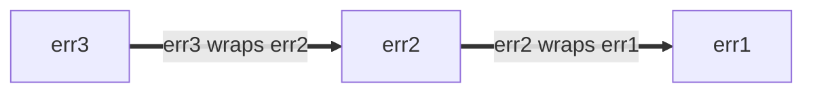

<!--* toc_depth: 3 *-->

# Go Style 最佳实践

https://google.github.io/styleguide/go/best-practices

[概览](index) | [指南](guide) | [决策](decisions) |
[最佳实践](best-practices)

<!--

-->



**注意：** 本文是阐述 Google [Go Style](index) 的系列文档之一。
本文档**既非[规范性的](index#normative)也非
[权威的](index#canonical)**，是[核心风格指南](guide)的辅助文档。
更多信息请参阅[概览](index#about)。

<a id="about"></a>

## 关于

本文件记录**如何最佳地应用 Go Style Guide 的指导**。
这些指导面向频繁出现的常见情形，但可能
并不适用于每一种情况。在可能的情况下，会讨论多种替代方法，
并附上在决定何时应用、何时不应用这些方法时
所需考虑的各项因素。

全套 Style Guide 文档请参阅[概览](index#about)。

<a id="naming"></a>

## 命名

<a id="function-names"></a>

### 函数与方法名

<a id="function-name-repetition"></a>

#### 避免重复

为函数或方法选择名称时，请考虑该名称将在
何种上下文中被阅读。请遵循以下建议，以避免在调用处出现多余的
[重复](decisions#repetition)：

*   函数与方法名中通常可以省略以下内容：

    *   输入与输出的类型（在没有冲突时）
    *   方法接收者的类型
    *   输入或输出是否为指针

*   对于函数，请勿
    [重复包名](decisions#repetitive-with-package)。

    <div class='badcode'></div>

    ```go
    package yamlconfig

    func ParseYAMLConfig(input string) (*Config, error)
    ```

    <div class='goodcode'></div>

    ```go
    package yamlconfig

    func Parse(input string) (*Config, error)
    ```

*   对于方法，请勿重复方法接收者的名称。

    <div class='badcode'></div>

    ```go
    func (c *Config) WriteConfigTo(w io.Writer) (int64, error)
    ```

    <div class='goodcode'></div>

    ```go
    func (c *Config) WriteTo(w io.Writer) (int64, error)
    ```

*   请勿重复作为参数传入的变量名。

    <div class='badcode'></div>

    ```go
    func OverrideFirstWithSecond(dest, source *Config) error
    ```

    <div class='goodcode'></div>

    ```go
    func Override(dest, source *Config) error
    ```

*   请勿重复返回值的名称与类型。

    <div class='badcode'></div>

    ```go
    func TransformToJSON(input *Config) *jsonconfig.Config
    ```

    <div class='goodcode'></div>

    ```go
    func Transform(input *Config) *jsonconfig.Config
    ```

当需要区分名称相近的函数时，
可以加入额外的信息。

<div class='goodcode'></div>

```go
func (c *Config) WriteTextTo(w io.Writer) (int64, error)
func (c *Config) WriteBinaryTo(w io.Writer) (int64, error)
```

<a id="function-name-conventions"></a>

#### 命名约定

为函数和方法选择名称时，还有
一些其他常见约定：

*   返回某种值的函数使用名词性的名称。

    <div class='goodcode'></div>

    ```go
    func (c *Config) JobName(key string) (value string, ok bool)
    ```

    由此可得的一个推论是，函数与方法名应当
    [避免使用 `Get` 前缀](decisions#getters)。

    <div class='badcode'></div>

    ```go
    func (c *Config) GetJobName(key string) (value string, ok bool)
    ```

*   执行某种操作的函数使用动词性的名称。

    <div class='goodcode'></div>

    ```go
    func (c *Config) WriteDetail(w io.Writer) (int64, error)
    ```

*   功能相同、仅涉及类型不同的函数，会在
    名称末尾带上类型名。

    <div class='goodcode'></div>

    ```go
    func ParseInt(input string) (int, error)
    func ParseInt64(input string) (int64, error)
    func AppendInt(buf []byte, value int) []byte
    func AppendInt64(buf []byte, value int64) []byte
    ```

    如果存在明确的「主要」版本，则该版本的名称中
    可以省略类型：

    <div class='goodcode'></div>

    ```go
    func (c *Config) Marshal() ([]byte, error)
    func (c *Config) MarshalText() (string, error)
    ```

<a id="naming-doubles"></a>

### 测试替身与辅助包

对于为提供测试辅助功能、尤其是 [test doubles] 的包与类型进行 [naming]，
可以遵循若干准则。测试替身可以是
stub、fake、mock 或 spy。

这些示例大多使用 stub。如果你的代码使用
fake 或其他种类的测试替身，请相应调整名称。

[naming]: guide#naming
[test doubles]: https://abseil.io/resources/swe-book/html/ch13.html#basic_concepts

假设你有一个职责单一的包，提供类似下面这样的
生产代码：

```go
package creditcard

import (
    "errors"

    "path/to/money"
)

// ErrDeclined indicates that the issuer declines the charge.
var ErrDeclined = errors.New("creditcard: declined")

// Card contains information about a credit card, such as its issuer,
// expiration, and limit.
type Card struct {
    // omitted
}

// Service allows you to perform operations with credit cards against external
// payment processor vendors like charge, authorize, reimburse, and subscribe.
type Service struct {
    // omitted
}

func (s *Service) Charge(c *Card, amount money.Money) error { /* omitted */ }
```

<a id="naming-doubles-helper-package"></a>

#### 创建测试辅助包

假设你想为另一个包创建一个包含测试替身的包。
本示例将使用上面的 `package creditcard`：

一种做法是基于生产包引入一个用于测试的
新 Go 包。稳妥的选择是在原包名后追加单词 `test`
（"creditcard" + "test"）：

<div class='goodcode'></div>

```go
package creditcardtest
```

除非另有明确说明，以下各节中的所有示例均位于
`package creditcardtest` 中。

<a id="naming-doubles-simple"></a>

#### 简单情形

你想为 `Service` 添加一组测试替身。由于 `Card` 实际上
是一个哑数据类型，类似于 Protocol Buffer 消息，在测试中
无需特殊处理，因此不需要替身。如果你预计只需要为
某一个类型（如 `Service`）准备测试替身，可以采用简洁的
方式来命名这些替身：

<div class='goodcode'></div>

```go
import (
    "path/to/creditcard"
    "path/to/money"
)

// Stub stubs creditcard.Service and provides no behavior of its own.
type Stub struct{}

func (Stub) Charge(*creditcard.Card, money.Money) error { return nil }
```

这严格优于 `StubService` 这样的命名，也远优于
糟糕的 `StubCreditCardService`，因为基础包名及其领域类型
已经暗示了 `creditcardtest.Stub` 是什么。

最后，如果该包使用 Bazel 构建，请确保新的 `go_library` 规则
被标记为 `testonly`：

<div class='goodcode'></div>

```build
go_library(
    name = "creditcardtest",
    srcs = ["creditcardtest.go"],
    deps = [
        ":creditcard",
        ":money",
    ],
    testonly = True,
)
```

上述做法是约定俗成的，其他工程师也能
较好地理解。

另请参阅：

*   [Go Tip #42: Authoring a Stub for Testing](https://google.github.io/styleguide/go/index.html#gotip)

<a id="naming-doubles-multiple-behaviors"></a>

#### 多种测试替身行为

当一种 stub 不够用时（例如，你还需要一个总是
失败的 stub），我们建议按其所模拟的行为来命名 stub。
这里我们把 `Stub` 重命名为 `AlwaysCharges`，并引入一个名为
`AlwaysDeclines` 的新 stub：

<div class='goodcode'></div>

```go
// AlwaysCharges stubs creditcard.Service and simulates success.
type AlwaysCharges struct{}

func (AlwaysCharges) Charge(*creditcard.Card, money.Money) error { return nil }

// AlwaysDeclines stubs creditcard.Service and simulates declined charges.
type AlwaysDeclines struct{}

func (AlwaysDeclines) Charge(*creditcard.Card, money.Money) error {
    return creditcard.ErrDeclined
}
```

<a id="naming-doubles-multiple-types"></a>

#### 多个类型对应多个替身

但现在假设 `package creditcard` 包含多个值得为其
创建替身的类型，如下面的 `Service` 与 `StoredValue`：

```go
package creditcard

type Service struct {
    // omitted
}

type Card struct {
    // omitted
}

// StoredValue manages customer credit balances.  This applies when returned
// merchandise is credited to a customer's local account instead of processed
// by the credit issuer.  For this reason, it is implemented as a separate
// service.
type StoredValue struct {
    // omitted
}

func (s *StoredValue) Credit(c *Card, amount money.Money) error { /* omitted */ }
```

在这种情况下，采用更明确的测试替身命名是合理的：

<div class='goodcode'></div>

```go
type StubService struct{}

func (StubService) Charge(*creditcard.Card, money.Money) error { return nil }

type StubStoredValue struct{}

func (StubStoredValue) Credit(*creditcard.Card, money.Money) error { return nil }
```

<a id="naming-doubles-local-variables"></a>

#### 测试中的局部变量

当测试中的变量指向替身时，请选择一个能基于上下文
最清晰地把该替身与其他生产类型区分开来的名称。
请看下面这段要测试的生产代码：

```go
package payment

import (
    "path/to/creditcard"
    "path/to/money"
)

type CreditCard interface {
    Charge(*creditcard.Card, money.Money) error
}

type Processor struct {
    CC CreditCard
}

var ErrBadInstrument = errors.New("payment: instrument is invalid or expired")

func (p *Processor) Process(c *creditcard.Card, amount money.Money) error {
    if c.Expired() {
        return ErrBadInstrument
    }
    return p.CC.Charge(c, amount)
}
```

在测试中，一个用于 `CreditCard`、称为 "spy" 的测试替身
与生产类型并列出现，因此给名称加上前缀可能提升清晰度。

<div class='goodcode'></div>

```go
package payment

import "path/to/creditcardtest"

func TestProcessor(t *testing.T) {
    var spyCC creditcardtest.Spy
    proc := &Processor{CC: spyCC}

    // declarations omitted: card and amount
    if err := proc.Process(card, amount); err != nil {
        t.Errorf("proc.Process(card, amount) = %v, want nil", err)
    }

    charges := []creditcardtest.Charge{
        {Card: card, Amount: amount},
    }

    if got, want := spyCC.Charges, charges; !cmp.Equal(got, want) {
        t.Errorf("spyCC.Charges = %v, want %v", got, want)
    }
}
```

这比不加前缀的命名更清晰。

<div class='badcode'></div>

```go
package payment

import "path/to/creditcardtest"

func TestProcessor(t *testing.T) {
    var cc creditcardtest.Spy

    proc := &Processor{CC: cc}

    // declarations omitted: card and amount
    if err := proc.Process(card, amount); err != nil {
        t.Errorf("proc.Process(card, amount) = %v, want nil", err)
    }

    charges := []creditcardtest.Charge{
        {Card: card, Amount: amount},
    }

    if got, want := cc.Charges, charges; !cmp.Equal(got, want) {
        t.Errorf("cc.Charges = %v, want %v", got, want)
    }
}
```

<a id="shadowing"></a>

### 遮蔽

**注意：** 本说明使用了两个非正式术语：*stomping* 与 *shadowing*。
它们并非 Go 语言规范中的官方概念。

与许多编程语言一样，Go 拥有可变变量：对变量赋值
会改变其值。

<div class='goodcode'></div>

```go
func abs(i int) int {
    if i < 0 {
        i *= -1
    }
    return i
}
```

使用 `:=` 运算符的 [short variable declarations] 时，在某些情况下
并不会创建新变量。我们可以称之为 *stomping*。当原值不再需要时，
这样做是可以的。

<div class='goodcode'></div>

```go
// innerHandler is a helper for some request handler, which itself issues
// requests to other backends.
func (s *Server) innerHandler(ctx context.Context, req *pb.MyRequest) *pb.MyResponse {
    // Unconditionally cap the deadline for this part of request handling.
    ctx, cancel := context.WithTimeout(ctx, 3*time.Second)
    defer cancel()
    ctxlog.Info(ctx, "Capped deadline in inner request")

    // Code here no longer has access to the original context.
    // This is good style if when first writing this, you anticipate
    // that even as the code grows, no operation legitimately should
    // use the (possibly unbounded) original context that the caller provided.

    // ...
}
```

不过，在新的作用域中使用短变量声明要小心：那
会引入一个新变量。我们可以称之为对原变量的 *shadowing*。
代码块结束之后的代码引用的是原变量。下面是一个有缺陷的尝试，
试图有条件地缩短 deadline：

<div class='badcode'></div>

```go
func (s *Server) innerHandler(ctx context.Context, req *pb.MyRequest) *pb.MyResponse {
    // Attempt to conditionally cap the deadline.
    if *shortenDeadlines {
        ctx, cancel := context.WithTimeout(ctx, 3*time.Second)
        defer cancel()
        ctxlog.Info(ctx, "Capped deadline in inner request")
    }

    // BUG: "ctx" here again means the context that the caller provided.
    // The above buggy code compiled because both ctx and cancel
    // were used inside the if statement.

    // ...
}
```

正确的代码版本可能是：

<div class='goodcode'></div>

```go
func (s *Server) innerHandler(ctx context.Context, req *pb.MyRequest) *pb.MyResponse {
    if *shortenDeadlines {
        var cancel func()
        // Note the use of simple assignment, = and not :=.
        ctx, cancel = context.WithTimeout(ctx, 3*time.Second)
        defer cancel()
        ctxlog.Info(ctx, "Capped deadline in inner request")
    }
    // ...
}
```

在我们称为 stomping 的情形中，由于没有新变量，被赋值
的类型必须与原变量的类型一致。而在 shadowing 中，引入的是一个
全新的实体，因此它可以具有不同的类型。有意的 shadowing
可能是一种有用的做法，但如果换一个新名称能提升
[清晰性](guide#clarity)，则始终可以这样做。

除了极小的作用域之外，使用与标准包同名的变量
并不是个好主意，因为这会使来自该包的自由函数和值
无法访问。反过来，在为自己的包挑选名称时，
应避免使用那些很可能需要
[导入重命名](decisions#import-renaming)、或者会在调用方造成对本来
不错的变量名产生遮蔽的名称。

<div class='badcode'></div>

```go
func LongFunction() {
    url := "https://example.com/"
    // Oops, now we can't use net/url in code below.
}
```

[short variable declarations]: https://go.dev/ref/spec#Short_variable_declarations

<a id="util-packages"></a>

### Util 包

Go 包的名称由 `package` 声明指定，与
导入路径相互独立。相比路径，包名对可读性影响更大。

Go 包名应当
[与包所提供的内容相关](decisions#package-names)。仅仅把
包命名为 `util`、`helper`、`common` 之类通常是个糟糕的选择（不过它
可以作为名称的*一部分*）。缺乏信息量的名称会让代码
更难阅读，而且如果使用得过于宽泛，还容易引发不必要的
[导入冲突](decisions#import-renaming)。

相反，请考虑调用处看起来会是什么样。

<div class='goodcode'></div>

```go
db := spannertest.NewDatabaseFromFile(...)

_, err := f.Seek(0, io.SeekStart)

b := elliptic.Marshal(curve, x, y)
```

即使不知道导入列表，你也大致能看出每一句在做什么
（`cloud.google.com/go/spanner/spannertest`、`io` 和 `crypto/elliptic`）。
若名称不够聚焦，这些代码可能会读作：

<div class='badcode'></div>

```go
db := test.NewDatabaseFromFile(...)

_, err := f.Seek(0, common.SeekStart)

b := helper.Marshal(curve, x, y)
```

<a id="package-size"></a>

## 包的大小

如果你在思考 Go 包应该多大，以及是否应该
把相关的类型放在同一个包里还是拆分到不同的包中，
一个不错的起点是[关于包名的 Go 博客文章][blog-pkg-names]。
尽管文章标题如此，它并不只讲命名。其中包含一些有用的
提示，并引用了若干有价值的文章与演讲。

以下是一些其他的考量与说明。

用户会在一个页面里看到该包的 [godoc]，由包所提供的类型
导出的方法会按类型分组。Godoc 还会把构造函数
与它们所返回的类型归在一起。如果*客户端代码*很可能需要两个
不同类型的值彼此交互，那么把它们放在同一个包里
对用户来说可能更方便。

同一个包内的代码可以访问包中未导出的标识符。如果你
有几个*实现*紧密耦合的相关类型，把它们
放在同一个包里，就能实现这种耦合，而不会用这些细节
污染公开 API。检验这种耦合的一个好办法是，设想有
两个包的一位假想用户，这两个包涵盖密切相关的
主题：如果用户必须同时导入两个包，才能以任何有意义的方式
使用其中任意一个，那么把它们合并通常是正确的做法。
标准库通常很好地体现了这种作用域划分与分层。

话虽如此，把整个项目放进单个包里
很可能会让这个包过于庞大。当某些内容在概念上彼此独立时，
为它单独设立一个小包会让它更易用。客户端所熟知的包短名
与导出的类型名共同作用，
构成含义明确的标识符：例如 `bytes.Buffer`、`ring.New`。
[Package Names 博客文章][blog-pkg-names]中有更多示例。

Go 风格对文件大小很灵活，因为维护者可以在
包内把代码从一个文件移到另一个文件，而不影响调用方。但作为
一般准则：单个文件包含数千行代码，或者
存在大量极小的文件，通常都不是好主意。并不存在某些
其他语言里的「一种类型一个文件」约定。经验法则是，文件应当
足够聚焦，让维护者能判断某个内容位于哪个文件，
同时文件应当足够小，以便找到之后易于定位。
标准库经常把大包拆分到若干源文件中，
按文件对相关代码分组。[package `bytes`] 的源码就是一个好例子。
包文档较长的包可以选择专门用一个名为
`doc.go` 的文件，其中只包含[包文档](decisions#package-comments)、
package 声明，别无其他，但这并非强制要求。

在 Google 代码库以及使用 Bazel 的项目中，Go 代码的
目录布局与开源 Go 项目中的不同：你可以在
单个目录中放置多个 `go_library` 目标。让每个包
独占一个目录的一个好理由是，你预计将来会把项目开源。

下面给出几个非权威的参考示例，以帮助展示这些理念
在实际中的应用：

*   只包含单一内聚概念、既无需再添加
    也无需再删减任何内容的小包：

    *   [package `csv`][package `csv`]：CSV 数据的编码与解码，
        职责分别由 [reader.go] 与 [writer.go] 承担。
    *   [package `expvar`][package `expvar`]：白盒程序遥测，全部
        包含在 [expvar.go] 中。

*   规模适中、包含单个较大领域及其多项
    职责的包：

    *   [package `flag`][package `flag`]：命令行标志管理，全部
        包含在 [flag.go] 中。

*   把若干密切相关的领域分散到多个
    文件中的大包：

    *   [package `http`][package `http`]：HTTP 的核心：
        [client.go][http-client]，支持 HTTP 客户端；
        [server.go][http-client]，支持 HTTP 服务端；[cookie.go]，cookie
        管理。
    *   [package `os`][package `os`]：跨平台操作系统
        抽象：[exec.go]，子进程管理；[file.go]，文件
        管理；[tempfile.go]，临时文件。

另请参阅：

*   [测试替身包](#naming-doubles)
*   [Organizing Go Code (Blog Post)]
*   [Organizing Go Code (Presentation)]

[blog-pkg-names]: https://go.dev/blog/package-names
[package `bytes`]: https://go.dev/src/bytes/
[Organizing Go Code (Blog Post)]: https://go.dev/blog/organizing-go-code
[Organizing Go Code (Presentation)]: https://go.dev/talks/2014/organizeio.slide
[package `csv`]: https://pkg.go.dev/encoding/csv
[reader.go]: https://go.googlesource.com/go/+/refs/heads/master/src/encoding/csv/reader.go
[writer.go]: https://go.googlesource.com/go/+/refs/heads/master/src/encoding/csv/writer.go
[package `expvar`]: https://pkg.go.dev/expvar
[expvar.go]: https://go.googlesource.com/go/+/refs/heads/master/src/expvar/expvar.go
[package `flag`]: https://pkg.go.dev/flag
[flag.go]: https://go.googlesource.com/go/+/refs/heads/master/src/flag/flag.go
[godoc]: https://pkg.go.dev/
[package `http`]: https://pkg.go.dev/net/http
[http-client]: https://go.googlesource.com/go/+/refs/heads/master/src/net/http/client.go
[http-server]: https://go.googlesource.com/go/+/refs/heads/master/src/net/http/server.go
[cookie.go]: https://go.googlesource.com/go/+/refs/heads/master/src/net/http/cookie.go
[package `os`]: https://pkg.go.dev/os
[exec.go]: https://go.googlesource.com/go/+/refs/heads/master/src/os/exec.go
[file.go]: https://go.googlesource.com/go/+/refs/heads/master/src/os/file.go
[tempfile.go]: https://go.googlesource.com/go/+/refs/heads/master/src/os/tempfile.go

<a id="imports"></a>

## 导入

<a id="import-protos"></a>

### Protocol Buffer 消息与 Stub

由于 Proto 库具有跨语言特性，其导入的处理方式
与标准 Go 导入不同。重命名 proto 导入的约定
基于生成该包的规则：

*   `pb` 后缀通常用于 `go_proto_library` 规则。
*   `grpc` 后缀通常用于 `go_grpc_library` 规则。

通常会使用描述该包的单个单词：

<div class='goodcode'></div>

```go
import (
    foopb "path/to/package/foo_service_go_proto"
    foogrpc "path/to/package/foo_service_go_grpc"
)
```

请遵循关于
[包名](https://google.github.io/styleguide/go/decisions#package-names)的风格指导。
优先使用完整单词。短名称很好，但要避免歧义。拿不准时，
使用 proto 包名中 _go 之前的部分并加上 pb 后缀：

<div class='goodcode'></div>

```go
import (
    pushqueueservicepb "path/to/package/push_queue_service_go_proto"
)
```

**注意：** 之前的指导鼓励使用极短的名称，例如 "xpb" 甚至
仅仅 "pb"。新代码应优先使用更具描述性的名称。使用了短名称的
现有代码不应被当作范例，但也无需
改动。

<a id="import-order"></a>

### 导入顺序

请参阅 [Go Style Decisions: Import grouping](decisions.md#import-grouping)。

<a id="error-handling"></a>

## 错误处理

在 Go 中，[errors are values]；错误由代码创建，也由代码消费。
错误可以：

*   转换为诊断信息，展示给人类
*   由维护者使用
*   由最终用户解读

错误信息还会出现在多种不同的界面中，包括日志
消息、错误转储以及渲染后的 UI。

处理（产生或消费）错误的代码应当审慎为之。忽略或
盲目传递错误返回值往往很有诱惑力。然而，
始终值得考虑的是，调用栈中当前的函数是否
处于最能有效处理该错误的位置。这是个很大的话题，
很难给出一刀切的建议。请运用你的判断，但请牢记以下
考量：

*   创建错误值时，请决定是否为它赋予任何
    [结构](#error-structure)。
*   处理错误时，请考虑[补充信息](#error-extra-info)，
    即那些你掌握、而调用方和/或被调方可能没有的信息。
*   另请参阅关于[错误日志](#error-logging)的指导。

虽然忽略错误通常并不合适，但有一个合理的例外：
在编排相关操作时，往往只有第一个
错误是有用的。[`errgroup`] 包为一组
可以整体失败或整体取消的操作提供了便利的抽象。

[errors are values]: https://go.dev/blog/errors-are-values
[`errgroup`]: https://pkg.go.dev/golang.org/x/sync/errgroup

另请参阅：

*   [Effective Go on errors](https://go.dev/doc/effective_go#errors)
*   [A post by the Go Blog on errors](https://go.dev/blog/go1.13-errors)
*   [Package `errors`](https://pkg.go.dev/errors)
*   [Package `upspin.io/errors`](https://commandcenter.blogspot.com/2017/12/error-handling-in-upspin.html)
*   [GoTip #89: When to Use Canonical Status Codes as Errors](https://google.github.io/styleguide/go/index.html#gotip)
*   [GoTip #48: Error Sentinel Values](https://google.github.io/styleguide/go/index.html#gotip)
*   [GoTip #13: Designing Errors for Checking](https://google.github.io/styleguide/go/index.html#gotip)

<a id="error-structure"></a>

### 错误结构

如果调用方需要检视错误（例如区分不同的错误
情形），请为错误值赋予结构，使这件事能够
以编程方式完成，而不是让调用方去做字符串匹配。
这条建议既适用于生产代码，也适用于关注不同
错误情形的测试。

最简单的结构化错误是不带参数的全局值。

```go
type Animal string

var (
    // ErrDuplicate occurs if this animal has already been seen.
    ErrDuplicate = errors.New("duplicate")

    // ErrMarsupial occurs because we're allergic to marsupials outside Australia.
    // Sorry.
    ErrMarsupial = errors.New("marsupials are not supported")
)

func process(animal Animal) error {
    switch {
    case seen[animal]:
        return ErrDuplicate
    case marsupial(animal):
        return ErrMarsupial
    }
    seen[animal] = true
    // ...
    return nil
}
```

调用方只需把函数返回的错误值与
某个已知的错误值进行比较：

<div class='goodcode'></div>

```go
func handlePet(...) {
    switch err := process(an); err {
    case ErrDuplicate:
        return fmt.Errorf("feed %q: %v", an, err)
    case ErrMarsupial:
        // Try to recover with a friend instead.
        alternate = an.BackupAnimal()
        return handlePet(..., alternate, ...)
    }
}
```

上面使用的是哨兵值，即错误必须与预期值相等（在
`==` 的意义上）。这在许多情况下完全够用。如果
`process` 返回被包装的错误（下文讨论），可以使用 [`errors.Is`]。

<div class='goodcode'></div>

```go
func handlePet(...) {
    switch err := process(an); {
    case errors.Is(err, ErrDuplicate):
        return fmt.Errorf("feed %q: %v", an, err)
    case errors.Is(err, ErrMarsupial):
        // ...
    }
}
```

不要试图根据错误的字符串形式来区分错误。（参见
[Go Tip #13: Designing Errors for Checking](https://google.github.io/styleguide/go/index.html#gotip)
了解更多。）

<div class='badcode'></div>

```go
func handlePet(...) {
    err := process(an)
    if regexp.MatchString(`duplicate`, err.Error()) {...}
    if regexp.MatchString(`marsupial`, err.Error()) {...}
}
```

如果错误中还包含调用方需要以编程方式获取的
额外信息，那么最好以结构化的形式呈现。例如，
[`os.PathError`] 类型的文档说明，它会把失败操作的
路径名放在一个结构体字段中，供调用方轻松访问。

也可以酌情使用其他错误结构，例如项目自定义的
包含错误码与详情字符串的结构体。[Package `status`][status] 是一种
常见的封装；如果你选择这种方式（并非强制），
请使用 [canonical codes]。参见
[Go Tip #89: When to Use Canonical Status Codes as Errors](https://google.github.io/styleguide/go/index.html#gotip)
以了解使用状态码是否是正确选择。

[`os.PathError`]: https://pkg.go.dev/os#PathError
[`errors.Is`]: https://pkg.go.dev/errors#Is
[`errors.As`]: https://pkg.go.dev/errors#As
[`package cmp`]: https://pkg.go.dev/github.com/google/go-cmp/cmp
[status]: https://pkg.go.dev/google.golang.org/grpc/status
[canonical codes]: https://pkg.go.dev/google.golang.org/grpc/codes

<a id="error-extra-info"></a>

### 为错误补充信息

为错误补充信息时，请避免加入底层错误
已经提供的冗余信息。例如，`os` 包的错误中
已经包含路径信息。

<div class='goodcode'></div>

```go
if err := os.Open("settings.txt"); err != nil {
  return fmt.Errorf("load launch code settings: %v", err)
}

// Output:
//
// load launch code settings: open settings.txt: no such file or directory
```

这里，"load launch code settings" 为 `os.Open` 的错误
补充了与当前函数上下文相关的具体含义，而没有重复
底层的文件路径信息。

<div class='badcode'></div>

```go
if err := os.Open("settings.txt"); err != nil {
  return fmt.Errorf("could not open settings.txt: %v", err)
}

// Output:
//
// could not open settings.txt: open settings.txt: no such file or directory
```

如果注解的唯一目的只是表明发生了失败，而没有
补充新信息，就不要添加它。错误本身的存在已足以
向调用方传达失败。

<div class='badcode'></div>

```go
return fmt.Errorf("failed: %v", err) // just return err instead
```

包装错误时，消息应编码失败的操作，并带上
上下文信息，但不要使用停用词。"failed to"、"couldn't" 或
"unable to" 之类的停用词不增加任何有用信息，还会导致重复的错误链（例如
`failed to X: failed to Y: failed to Z: error`）。

<div class='badcode'></div>

```go
func (s *server) setupTLS(certPath string) error {
  data, err := os.ReadFile(certPath)
  if err != nil {
    return fmt.Errorf("failed to setup TLS: %v", err)
  }
  if err := s.validateCert(data); err != nil {
    return fmt.Errorf("failed to setup TLS: %v", err)
  }
  if err := s.applyCert(data); err != nil {
    return fmt.Errorf("failed to setup TLS: %v", err)
  }
  return nil
}
```

单个函数可能执行多项操作，因此要写清楚失败的是哪一项：

<div class='goodcode'></div>

```go
func (s *server) setupTLS(certPath string) error {
  data, err := os.ReadFile(certPath)
  if err != nil {
    // Note: os.ReadFile already includes the file path in its error
    // (e.g., "open cert.pem: no such file"), so we don't repeat it here.
    return fmt.Errorf("load certificate: %v", err)
  }
  if err := s.validateCert(data); err != nil {
    return fmt.Errorf("verify signature from %s: %v", certPath, err)
  }
  if err := s.applyCert(data); err != nil {
    return fmt.Errorf("apply certificate from %s: %v", certPath, err)
  }
  return nil
}
```

用 `fmt.Errorf`
[包装错误时在 `%v` 与 `%w` 之间做出选择](https://go.dev/blog/go1.13-errors#whether-to-wrap)
是一个需要细致权衡的决定，它会显著影响错误
在应用内被传播、处理、检视和记录的方式。
核心原则是让错误值对其观察者有用，无论这些
观察者是人还是代码。

1.  **用于简单注解或新错误的 `%v`**

    `%v` 动词是对任意 Go 值进行字符串格式化的
    通用工具，包括错误在内。与 `fmt.Errorf` 配合使用时，它会把错误的
    字符串表示（即其 `Error()` 方法的返回值）嵌入到一个
    新的错误值中，同时丢弃原错误中的任何结构化信息。
    适合使用 `%v` 的例子：

    *   补充有意义、非冗余的上下文：如上例所示。

    *   记录或展示错误：当主要目标是在日志中或向用户
        呈现人类可读的错误消息，并且你不打算
        让调用方以编程方式对错误执行 `errors.Is` 或 `errors.As` 时
        （注意：此处通常不推荐 `errors.Unwrap`，因为它
        不处理多错误）。

    *   创建全新的、独立的错误：有时需要
        把一个错误转换为新的错误消息，借此隐藏
        原错误的具体细节。这种做法在系统边界处
        尤其有益，包括但不限于 RPC、IPC
        和存储；在这些地方，我们把领域特定的错误转换为权威的
        错误空间。

        <div class='goodcode'></div>

        ```go
        func (*FortuneTeller) SuggestFortune(context.Context, *pb.SuggestionRequest) (*pb.SuggestionResponse, error) {
          // ...
          if err != nil {
            return nil, fmt.Errorf("find fortune database: %v", err)
          }
        }
        ```

        我们也可以在上面的示例中显式标注 RPC 状态码
        `Internal`：

        <div class='goodcode'></div>

        ```go
        import (
          "google.golang.org/grpc/codes"
          "google.golang.org/grpc/status"
        )

        func (*FortuneTeller) SuggestFortune(context.Context, *pb.SuggestionRequest) (*pb.SuggestionResponse, error) {
          // ...
          if err != nil {
            // Or use fmt.Errorf with the %w verb if deliberately wrapping an
            // error which the caller is meant to unwrap.
            return nil, status.Errorf(codes.Internal, "couldn't find fortune database", status.ErrInternal)
          }
        }
        ```

1.  **用于编程式检视与错误链的 `%w`（包装）**

    `%w` 动词是专为错误包装而设计的。它会创建一个
    带有 `Unwrap()` 方法的新错误，使调用方能够
    使用 `errors.Is` 和 `errors.As` 以编程方式检视错误链。
    适合使用 `%w` 的例子：

    *   在补充上下文的同时保留原错误，以供编程式
        检视：这是应用内辅助函数的主要用例。
        你希望为错误补充额外的上下文（例如，
        失败时正在执行何种操作），但仍允许
        调用方检查底层错误是否为某个特定的哨兵错误
        或类型。

        <div class='goodcode'></div>

        ```go
        func (s *Server) internalFunction(ctx context.Context) error {
          // ...
          if err != nil {
            return fmt.Errorf("find remote file: %w", err)
          }
        }
        ```

        这使得更上层的函数可以执行
        `errors.Is(err, fs.ErrNotExist)`，前提是底层错误是
        `fs.ErrNotExist`，即便它已被包装。

        在系统与外部系统（如 RPC、
        IPC 或存储）交互的地方，通常更好的做法是把领域特定的错误
        转换成标准化的错误空间（例如 gRPC 状态码），而不是
        简单地用 `%w` 包装原始的底层错误。客户端通常
        并不关心确切的内部文件系统错误；它们关心的是
        权威的结果（例如 `Internal`、`NotFound`、`PermissionDenied`）。

    *   当你明确记录并测试所暴露的底层错误时：
        如果你的包的 API 保证某些底层错误可以被
        调用方解包并检查（例如，"此函数可能返回
        包装在更通用错误中的 `ErrInvalidConfig`"），那么 `%w`
        是合适的。这构成了你的包契约的一部分。

另请参阅：

*   [错误文档约定](#documentation-conventions-errors)
*   [Blog post on error wrapping](https://blog.golang.org/go1.13-errors)

<a id="error-percent-w"></a>

### %w 在错误中的位置

如果你要使用 `%w` 格式化动词进行
[错误包装](https://go.dev/blog/go1.13-errors)，*则*应优先把 `%w`
放在错误字符串的末尾。

错误可以用 `%w` 动词包装，也可以把它们放进一个
[结构化错误](https://google.github.io/styleguide/go/index.html#gotip)中，该错误
实现了 `Unwrap() error`（例如
[`fs.PathError`](https://pkg.go.dev/io/fs#PathError)）。

被包装的错误会形成错误链：每新增一层包装，就会在
错误链的前端添加一个新条目。错误链可以通过
`Unwrap() error` 方法遍历。例如：

```go
err1 := fmt.Errorf("err1")
err2 := fmt.Errorf("err2: %w", err1)
err3 := fmt.Errorf("err3: %w", err2)
```

这形成了如下形式的错误链：



无论 `%w` 动词放在哪里，返回的错误始终
表示错误链的前端，而 `%w` 是下一个子节点。
同样地，`Unwrap() error` 始终从最新到最旧
遍历错误链。

不过，`%w` 动词的位置确实会影响错误链
是按从最新到最旧、从最旧到最新，还是都不是来打印：

<div class='goodcode'></div>

```go
err1 := fmt.Errorf("err1")
err2 := fmt.Errorf("err2: %w", err1)
err3 := fmt.Errorf("err3: %w", err2)
fmt.Println(err3) // err3: err2: err1
// err3 is a newest-to-oldest error chain, that prints newest-to-oldest.
```

<div class='badcode'></div>

```go
err1 := fmt.Errorf("err1")
err2 := fmt.Errorf("%w: err2", err1)
err3 := fmt.Errorf("%w: err3", err2)
fmt.Println(err3) // err1: err2: err3
// err3 is a newest-to-oldest error chain, that prints oldest-to-newest.
```

<div class='badcode'></div>

```go
err1 := fmt.Errorf("err1")
err2 := fmt.Errorf("err2-1 %w err2-2", err1)
err3 := fmt.Errorf("err3-1 %w err3-2", err2)
fmt.Println(err3) // err3-1 err2-1 err1 err2-2 err3-2
// err3 is a newest-to-oldest error chain, that neither prints newest-to-oldest
// nor oldest-to-newest.
```

因此，为了让错误文本与错误链结构相呼应，请优先
把 `%w` 动词放在末尾，采用 `[...]: %w` 的形式。

<a id="error-percent-w-sentinel-placement"></a>

#### 哨兵错误的位置

这条规则的一个例外是包装哨兵错误时。哨兵错误
是对失败进行主要归类的错误。它有助于
观察者快速理解失败的性质（例如 "not found" 或
"invalid argument"），而不必解析整条错误消息。
在错误字符串中尽早标出该错误类型
是有益的。

哨兵错误的例子包括 os 错误（例如 [`os.ErrInvalid`]）以及
包级错误。

在这些情况下，把 `%w` 动词放在错误字符串的开头，
可以立即标明错误的类别，从而提升可读性。

<div class='goodcode'></div>

```go
package parser

var ErrParse = fmt.Errorf("parse error")

// This is another package error that could be returned.
var ErrParseInvalidHeader = fmt.Errorf("%w: invalid header", ErrParse)

func parseHeader() error {
  err := checkHeader()
  return fmt.Errorf("%w: invalid character in header: %v", ErrParseInvalidHeader, err)
}

err := fmt.Errorf("%w: find fortune database: %v", ErrInternal, err)
```

把状态放在开头，可以确保最相关的分类信息
最为醒目。

<div class='badcode'></div>

```go
package parser

var ErrParse = fmt.Errorf("parse error")

// This is another package error that could be returned.
var ErrParseInvalidHeader = fmt.Errorf("%w: invalid header", ErrParse)

func parseHeader() error {
  err := checkHeader()
  return fmt.Errorf("invalid character in header: %v: %w", err, ErrParseInvalidHeader)
}

var ErrInternal = status.Error(codes.Internal, "internal")
err2 := fmt.Errorf("find fortune database: %v: %w", err, ErrInternal)
```

如果把它放在末尾，阅读错误文本时就更难识别错误类别，
因为它被埋没在具体的错误细节之中。

[`os.ErrInvalid`]: https://pkg.go.dev/os#ErrInvalid

另请参阅：

*   [Go Tip #48: Error Sentinel Values]
*   [Go Tip #106: Error Naming Conventions]

[commentary]: decisions#commentary
[Go Tip #48: Error Sentinel Values]: https://google.github.io/styleguide/go/index.html#gotip
[Go Tip #106: Error Naming Conventions]: https://google.github.io/styleguide/go/index.html#gotip

<a id="error-logging"></a>

### 记录错误日志

函数有时需要把错误告知外部系统，而不
把它传播给调用方。记录日志是显而易见的选择；但请
留意记录什么、以及如何记录错误。

*   与 [good test failure messages] 类似，日志消息应清楚表达
    出了什么问题，并通过包含相关信息来
    帮助维护者诊断问题。

*   避免重复。如果你要返回错误，通常最好不要自己记录，
    而是交给调用方处理。调用方可以选择记录
    该错误，或使用 [`rate.Sometimes`] 对日志做限速。
    其他选择包括尝试恢复，甚至 [stopping the program]。无论
    哪种情况，把控制权交给调用方都有助于避免日志刷屏。

    不过，这种做法的缺点是，任何日志都是
    用调用方的行坐标写入的。

*   小心处理 [PII]。许多日志接收端并不适合存放
    敏感的终端用户信息。

*   谨慎使用 `log.Error`。ERROR 级别的日志会触发 flush，且比
    较低级别的日志开销更大。这可能对你的代码造成严重的
    性能影响。在 error 与 warning 级别之间抉择时，
    请遵循这样一条最佳实践：error 级别的消息应当
    具备可操作性，而不只是比 warning "更严重"。

*   在 Google 内部，我们有监控系统，可以配置出比
    写入日志文件并指望有人注意到更有效的告警。
    这与标准库的
    [package `expvar`] 相似，但并不完全相同。

[good test failure messages]: https://google.github.io/styleguide/go/decisions#useful-test-failures
[stopping the program]: #checks-and-panics
[`rate.Sometimes`]: https://pkg.go.dev/golang.org/x/time/rate#Sometimes
[PII]: https://en.wikipedia.org/wiki/Personal_data
[package `expvar`]: https://pkg.go.dev/expvar

<a id="vlog"></a>

#### 自定义详细级别

善用详细日志（[`log.V`]）。详细日志对开发和追踪
很有用。围绕详细级别建立一套约定
会有所帮助。例如：

*   在 `V(1)` 写入少量额外信息
*   在 `V(2)` 追踪更多信息
*   在 `V(3)` 转储较大的内部状态

为了把详细日志的开销降到最低，应确保即使 `log.V` 关闭，
也不会意外调用开销较大的函数。`log.V` 提供了两种
API。更便捷的那一种带有这种意外开销的风险。
拿不准时，请使用稍显冗长的写法。

<div class='goodcode'></div>

```go
for _, sql := range queries {
  log.V(1).Infof("Handling %v", sql)
  if log.V(2) {
    log.Infof("Handling %v", sql.Explain())
  }
  sql.Run(...)
}
```

<div class='badcode'></div>

```go
// sql.Explain called even when this log is not printed.
log.V(2).Infof("Handling %v", sql.Explain())
```

[`log.V`]: https://pkg.go.dev/github.com/golang/glog#V

<a id="program-init"></a>

### 程序初始化

程序初始化错误（例如错误的 flag 和配置）应当
向上传播到 `main`，由 `main` 调用 `log.Exit`，并附带一条
说明如何修复该错误的错误信息。在这些情况下，通常不应使用 `log.Fatal`，
因为指向该检查的堆栈跟踪，多半不如一条
由人编写、具备可操作性的消息有用。

<a id="checks-and-panics"></a>

### 程序检查与 panic

正如 [decision against panics] 所述，标准错误处理应当
围绕错误返回值来组织。库应优先向调用方返回错误，
而不是中止程序，尤其是面对
临时性错误时。

有时有必要对某个不变量执行一致性检查，并在
其被违反时终止程序。一般来说，只有当
不变量检查失败意味着内部状态已经
不可恢复时才这样做。在 Google 代码库中，最可靠的做法是
调用 `log.Fatal`。在这些情况下使用 `panic` 并不可靠，因为
defer 函数有可能死锁，或进一步破坏内部或
外部状态。

同样地，要抵制通过 recover panic 来避免崩溃的诱惑，因为这样做
可能导致传播已损坏的状态。离 panic 越远，
你对程序状态了解得越少，而程序可能正持有锁
或其他资源。程序随后可能出现其他意外的故障模式，
使问题更难诊断。与其试图在代码中处理
意外的 panic，不如使用监控工具把意外故障暴露出来，
并以高优先级修复相关缺陷。

**注意：** 标准库的 [`net/http` server] 违反了这条建议，它会从
请求处理函数中 recover panic。经验丰富的 Go 工程师的共识是，
这是一个历史性的错误。如果你查看其他语言编写的
应用服务器的日志，常常会发现大量未处理的大段堆栈跟踪。
请在你的服务器中避免这个陷阱。

[decision against panics]: https://google.github.io/styleguide/go/decisions#dont-panic
[`net/http` server]: https://pkg.go.dev/net/http#Server

<a id="when-to-panic"></a>

### 何时使用 panic

标准库会在 API 被误用时触发 panic。例如，[`reflect`] 会在
许多情况下触发 panic：某个值被以某种方式访问，暗示它被
错误理解了。这类似于针对核心语言 bug 的 panic，例如
访问越界的切片元素。代码评审与测试
应当能发现这类 bug，它们不应出现在生产代码中。
这些 panic 充当不依赖于库的不变量检查，因为
标准库无法访问 Google 代码库所使用的
[levelled `log`] 包。

[`reflect`]: https://pkg.go.dev/reflect
[levelled `log`]: decisions#logging

panic 可能有用的另一种情形（虽不常见）是作为某个包的
内部实现细节：该包在调用链中始终有对应的 recover。
解析器以及类似的深层嵌套、紧耦合的内部函数
组可以从这种设计中获益：在这种场景下，层层传递错误返回值
只会增加复杂度而无实际价值。

这种设计的关键特征在于，这些 **panic 绝不允许
跨越包边界逃逸**，也不构成包 API 的一部分。
这通常通过一个顶层的 defer 函数来实现，它使用
`recover` 在公开 API 边界处把传播而来的 panic
转换为返回的错误。这要求触发 panic 与执行 recover 的代码
区分由代码自身引发的 panic 与并非由它引发的 panic：

<div class='goodcode'></div>

```go
type syntaxError struct {
  msg string
}

func parseInt(in string) int {
  n, err := strconv.Atoi(in)
  if err != nil {
    panic(&syntaxError{"not a valid integer"})
  }
}

func Parse(in string) (_ *Node, err error) {
  defer func() {
    if p := recover(); p != nil {
      sErr, ok := p.(*syntaxError)
      if !ok {
        panic(p) // Propagate the panic since it is outside our code's domain.
      }
      err = fmt.Errorf("syntax error: %v", sErr.msg)
    }
  }()
  ... // Parse input calling parseInt internally to parse integers
}
```

> **警告：** 采用这种模式的代码必须注意管理
> 与此类由 defer 管理的代码段相关联的所有资源（例如
> close、free 或 unlock）。
>
> 参见：[Go Tip #81: Avoiding Resource Leaks in API Design]

当编译器无法识别不可达代码时，也会使用 panic，
例如在使用 `log.Fatal` 这类不会返回的函数时：

<div class='goodcode'></div>

```go
func answer(i int) string {
    switch i {
    case 42:
        return "yup"
    case 54:
        return "base 13, huh"
    default:
        log.Fatalf("Sorry, %d is not the answer.", i)
        panic("unreachable")
    }
}
```

[请勿在 flag 解析之前调用 `log` 函数。](https://pkg.go.dev/github.com/golang/glog#pkg-overview)
如果你必须在包初始化函数（`init` 或
["must" 函数](decisions#must-functions)）中终止程序，可以用 panic 代替
致命日志调用。

另请参阅：

*   [Handling panics](https://go.dev/ref/spec#Handling_panics) 与
    [Run-time Panics](https://go.dev/ref/spec#Run_time_panics)，
    见语言规范
*   [Defer, Panic, and Recover](https://go.dev/blog/defer-panic-and-recover)
*   [On the uses and misuses of panics in Go](https://eli.thegreenplace.net/2018/on-the-uses-and-misuses-of-panics-in-go/)

[Go Tip #81: Avoiding Resource Leaks in API Design]: https://google.github.io/styleguide/go/index.html#gotip

<a id="documentation"></a>

## 文档

<a id="documentation-conventions"></a>

### 约定

本节是对 decisions 文档中 [commentary] 一节的补充。

以熟悉的风格编写文档的 Go 代码更易读，也更不容易
被误用，胜过文档有误或根本没有文档的代码。可运行的
[examples] 会显示在 Godoc 和 Code Search 中，是解释
如何使用你的代码的绝佳方式。

[examples]: decisions#examples

<a id="documentation-conventions-params"></a>

#### 参数与配置

并非每个参数都必须在文档中逐一列举。这适用于：

*   函数和方法参数
*   结构体字段
*   选项相关的 API

为容易出错或不明显的字段和参数编写文档，并说明
它们为何值得关注。

在下面的代码片段中，高亮显示的注释几乎没有给读者
带来什么有用的信息：

<div class='badcode'></div>

```go
// Sprintf formats according to a format specifier and returns the resulting
// string.
//
// format is the format, and data is the interpolation data.
func Sprintf(format string, data ...any) string
```

不过，这个片段展示了一个与前面类似的代码场景，其中的
注释转而陈述了不明显或对读者有实质帮助的
内容：

<div class='goodcode'></div>

```go
// Sprintf formats according to a format specifier and returns the resulting
// string.
//
// The provided data is used to interpolate the format string. If the data does
// not match the expected format verbs or the amount of data does not satisfy
// the format specification, the function will inline warnings about formatting
// errors into the output string as described by the Format errors section
// above.
func Sprintf(format string, data ...any) string
```

在选择要记录什么以及记录到何种深度时，请考虑你可能的受众。
维护者、团队新人、外部用户，甚至六个月后的你自己，
可能需要的信息与你最初着手编写文档时心里所想的
略有不同。

另见：

*   [GoTip #41: Identify Function Call Parameters]
*   [GoTip #51: Patterns for Configuration]

[commentary]: decisions#commentary
[GoTip #41: Identify Function Call Parameters]: https://google.github.io/styleguide/go/index.html#gotip
[GoTip #51: Patterns for Configuration]: https://google.github.io/styleguide/go/index.html#gotip

<a id="documentation-conventions-contexts"></a>

#### 上下文

上下文参数被取消时会中断接收它的函数，这一点是
不言自明的。如果该函数可以返回错误，按惯例
该错误就是 `ctx.Err()`。

这一事实无需重复说明：

<div class='badcode'></div>

```go
// Run executes the worker's run loop.
//
// The method will process work until the context is cancelled and accordingly
// returns an error.
func (Worker) Run(ctx context.Context) error
```

由于这一点是不言自明的，下面这样更好：

<div class='goodcode'></div>

```go
// Run executes the worker's run loop.
func (Worker) Run(ctx context.Context) error
```

当上下文行为有所不同或不明显时，若符合以下任一
情况，就应当明确写入文档。

*   当上下文被取消时，该函数返回 `ctx.Err()` 之外的
    错误：

    <div class='goodcode'></div>

    ```go
    // Run executes the worker's run loop.
    //
    // If the context is cancelled, Run returns a nil error.
    func (Worker) Run(ctx context.Context) error
    ```

*   该函数还有其他可能中断它或影响生命周期的机制：

    <div class='goodcode'></div>

    ```go
    // Run executes the worker's run loop.
    //
    // Run processes work until the context is cancelled or Stop is called.
    // Context cancellation is handled asynchronously internally: run may return
    // before all work has stopped. The Stop method is synchronous and waits
    // until all operations from the run loop finish. Use Stop for graceful
    // shutdown.
    func (Worker) Run(ctx context.Context) error

    func (Worker) Stop()
    ```

*   该函数对上下文的生命周期、派生关系或
    附加值有特殊要求：

    <div class='goodcode'></div>

    ```go
    // NewReceiver starts receiving messages sent to the specified queue.
    // The context should not have a deadline.
    func NewReceiver(ctx context.Context) *Receiver

    // Principal returns a human-readable name of the party who made the call.
    // The context must have a value attached to it from security.NewContext.
    func Principal(ctx context.Context) (name string, ok bool)
    ```

    **警告：** 避免设计出对调用方提出此类要求（例如上下文
    不得设置截止时间）的 API。上面只是举例说明在无法避免时
    该如何记录这一点，并非对这种模式的认可。

<a id="documentation-conventions-concurrency"></a>

#### 并发

Go 用户会默认概念上只读的操作可以安全地并发使用，
不需要额外的同步。

在这段 Godoc 中，关于并发的额外说明可以安全地删去：

```go
// Len returns the number of bytes of the unread portion of the buffer;
// b.Len() == len(b.Bytes()).
//
// It is safe to be called concurrently by multiple goroutines.
func (*Buffer) Len() int
```

然而，会修改状态的操作不会被默认为可安全并发使用，
需要用户自行考虑同步。

同样，这里关于并发的额外说明也可以安全地删去：

```go
// Grow grows the buffer's capacity.
//
// It is not safe to be called concurrently by multiple goroutines.
func (*Buffer) Grow(n int)
```

如果符合以下任一情况，强烈建议编写文档。

*   该操作是只读还是会修改状态并不明确：

    <div class='goodcode'></div>

    ```go
    package lrucache

    // Lookup returns the data associated with the key from the cache.
    //
    // This operation is not safe for concurrent use.
    func (*Cache) Lookup(key string) (data []byte, ok bool)
    ```

    为什么？查找键时命中缓存会在内部修改 LRU 缓存。并非所有读者
    都能一眼看出这是如何实现的。

*   同步由 API 提供：

    <div class='goodcode'></div>

    ```go
    package fortune_go_proto

    // NewFortuneTellerClient returns an *rpc.Client for the FortuneTeller service.
    // It is safe for simultaneous use by multiple goroutines.
    func NewFortuneTellerClient(cc *rpc.ClientConn) *FortuneTellerClient
    ```

    为什么？同步由 Stubby 提供。

    **注意：** 如果 API 本身是一个类型，且由该 API 完整提供同步，
    按惯例只在类型定义中说明这些语义。

*   该 API 接受用户实现的接口类型，而接口的
    使用方有特定的并发要求：

    <div class='goodcode'></div>

    ```go
    package health

    // A Watcher reports the health of some entity (usually a backend service).
    //
    // Watcher methods are safe for simultaneous use by multiple goroutines.
    type Watcher interface {
        // Watch sends true on the passed-in channel when the Watcher's
        // status has changed.
        Watch(changed chan<- bool) (unwatch func())

        // Health returns nil if the entity being watched is healthy, or a
        // non-nil error explaining why the entity is not healthy.
        Health() error
    }
    ```

    为什么？API 是否可被多个 goroutine 安全使用，是其
    契约的一部分。

<a id="documentation-conventions-cleanup"></a>

#### 清理

把 API 所有明确的清理要求都写入文档。否则调用方
将无法正确使用该 API，导致资源泄漏和其他潜在缺陷。

明确指出由调用方负责的清理工作：

<div class='goodcode'></div>

```go
// NewTicker returns a new Ticker containing a channel that will send the
// current time on the channel after each tick.
//
// Call Stop to release the Ticker's associated resources when done.
func NewTicker(d Duration) *Ticker

func (*Ticker) Stop()
```

如果如何清理资源可能不够明确，请加以说明：

<div class='goodcode'></div>

```go
// Get issues a GET to the specified URL.
//
// When err is nil, resp always contains a non-nil resp.Body.
// Caller should close resp.Body when done reading from it.
//
//    resp, err := http.Get("http://example.com/")
//    if err != nil {
//        // handle error
//    }
//    defer resp.Body.Close()
//    body, err := io.ReadAll(resp.Body)
func (c *Client) Get(url string) (resp *Response, err error)
```

另见：

*   [GoTip #110: Don’t Mix Exit With Defer]

[GoTip #110: Don’t Mix Exit With Defer]: https://google.github.io/styleguide/go/index.html#gotip

<a id="documentation-conventions-errors"></a>

#### 错误

把函数返回给调用方的重要错误哨兵值或错误类型写入
文档，以便调用方能够预先判断可以在自己的代码中
处理哪些类型的状况。

<div class='goodcode'></div>

```go
package os

// Read reads up to len(b) bytes from the File and stores them in b. It returns
// the number of bytes read and any error encountered.
//
// At end of file, Read returns 0, io.EOF.
func (*File) Read(b []byte) (n int, err error) {
```

当函数返回某个具体错误类型时，请正确注明该错误
是否为指针接收者：

<div class='goodcode'></div>

```go
package os

type PathError struct {
    Op   string
    Path string
    Err  error
}

// Chdir changes the current working directory to the named directory.
//
// If there is an error, it will be of type *PathError.
func Chdir(dir string) error {
```

注明返回的值是否为指针接收者，能让调用方正确地
使用 [`errors.Is`]、[`errors.As`] 和
[`package cmp`] 比较错误。这是因为非指针值
与指针值并不等价。

**注意：** 在 `Chdir` 示例中，返回类型写作 `error` 而非
`*PathError`，原因是
[nil 接口值的工作方式](https://go.dev/doc/faq#nil_error)。

当某类行为适用于包中出现的大多数错误时，请在
[包的文档](decisions#package-comments) 中记录整体的
错误约定：

<div class='goodcode'></div>

```go
// Package os provides a platform-independent interface to operating system
// functionality.
//
// Often, more information is available within the error. For example, if a
// call that takes a file name fails, such as Open or Stat, the error will
// include the failing file name when printed and will be of type *PathError,
// which may be unpacked for more information.
package os
```

恰当地运用这些方法，可以毫不费力地为
[错误附加额外信息](#error-extra-info)，并帮助
调用方避免添加多余的注解。

另见：

*   [Go Tip #106: Error Naming Conventions](https://google.github.io/styleguide/go/index.html#gotip)
*   [Go Tip #89: When to Use Canonical Status Codes as Errors](https://google.github.io/styleguide/go/index.html#gotip)

<a id="documentation-preview"></a>

### 预览

Go 提供了一个
[文档服务器](https://pkg.go.dev/golang.org/x/pkgsite/cmd/pkgsite)。
建议在代码评审之前和评审过程中都预览你的代码
所生成的文档。这有助于确认
[godoc formatting] 是否正确渲染。

[godoc formatting]: #godoc-formatting

<a id="godoc-formatting"></a>

### Godoc 格式

[Godoc] 提供了一些用于 [format documentation] 的专门语法。

*   需要用空行来分隔段落：

    <div class='goodcode'></div>

    ```go
    // LoadConfig reads a configuration out of the named file.
    //
    // See some/shortlink for config file format details.
    ```

*   测试文件可以包含 [runnable examples]，它们会显示在 godoc 中
    对应的文档旁边：

    <div class='goodcode'></div>

    ```go
    func ExampleConfig_WriteTo() {
      cfg := &Config{
        Name: "example",
      }
      if err := cfg.WriteTo(os.Stdout); err != nil {
        log.Exitf("Failed to write config: %s", err)
      }
      // Output:
      // {
      //   "name": "example"
      // }
    }
    ```

*   再额外缩进两个空格的行会按原样逐字呈现：

    <div class='goodcode'></div>

    ```go
    // Update runs the function in an atomic transaction.
    //
    // This is typically used with an anonymous TransactionFunc:
    //
    //   if err := db.Update(func(state *State) { state.Foo = bar }); err != nil {
    //     //...
    //   }
    ```

    不过请注意，把代码放进可运行示例，往往比把它
    写在注释里更合适。

    这种逐字排版也可用于 godoc 原生不支持的
    格式，例如列表和表格：

    <div class='goodcode'></div>

    ```go
    // LoadConfig reads a configuration out of the named file.
    //
    // LoadConfig treats the following keys in special ways:
    //   "import" will make this configuration inherit from the named file.
    //   "env" if present will be populated with the system environment.
    ```

*   以大写字母开头、除圆括号和逗号外不含任何标点、
    且后面紧接另一段落的单行，会被
    格式化为标题：

    <div class='goodcode'></div>

    ```go
    // The following line is formatted as a heading.
    //
    // Using headings
    //
    // Headings come with autogenerated anchor tags for easy linking.
    ```

[Godoc]: https://pkg.go.dev/
[format documentation]: https://go.dev/doc/comment
[runnable examples]: decisions#examples

<a id="signal-boost"></a>

### 强化信号

有时一行代码看起来像某种常见写法，实际上却并非如此。
这方面最典型的例子之一是 `err == nil` 检查，因为 `err != nil`
要常见得多。下面两个条件检查很难区分：

<div class='goodcode'></div>

```go
if err := doSomething(); err != nil {
    // ...
}
```

<div class='badcode'></div>

```go
if err := doSomething(); err == nil {
    // ...
}
```

你可以改为添加一条注释来「强化」该条件判断的信号：

<div class='goodcode'></div>

```go
if err := doSomething(); err == nil { // if NO error
    // ...
}
```

这条注释让读者注意到该条件判断中的差异。

<a id="vardecls"></a>

## 变量声明

<a id="vardeclinitialization"></a>

### 初始化

为保持一致，在用非零值初始化新变量时，
优先使用 `:=` 而非 `var`。

<div class='goodcode'></div>

```go
i := 42
```

<div class='badcode'></div>

```go
var i = 42
```

<a id="vardeclzero"></a>

### 用零值声明变量

以下声明使用了 [zero value]：

<div class='goodcode'></div>

```go
var (
    coords Point
    magic  [4]byte
    primes []int
)
```

[zero value]: https://golang.org/ref/spec#The_zero_value

当你想表达一个**可供后续使用**的空值时，应当使用零值
来声明。使用带显式初始化的复合字面量可能显得
笨重：

<div class='badcode'></div>

```go
var (
    coords = Point{X: 0, Y: 0}
    magic  = [4]byte{0, 0, 0, 0}
    primes = []int(nil)
)
```

零值声明的一个常见用途，是在反序列化时把某个变量
用作输出：

<div class='goodcode'></div>

```go
var coords Point
if err := json.Unmarshal(data, &coords); err != nil {
```

当你需要一个指针类型的变量时，也可以用下面这种形式
使用零值：

<div class='goodcode'></div>

```go
msg := new(pb.Bar) // or "&pb.Bar{}"
if err := proto.Unmarshal(data, msg); err != nil {
```

如果你的结构体中需要一个锁或其他[不得被复制](decisions#copying)的字段，
可以把它设为值类型，以便利用零值初始化。
这确实意味着外层类型现在必须通过指针而非值来传递，
该类型上的方法也必须使用指针接收者。

<div class='goodcode'></div>

```go
type Counter struct {
    // This field does not have to be "*sync.Mutex". However,
    // users must now pass *Counter objects between themselves, not Counter.
    mu   sync.Mutex
    data map[string]int64
}

// Note this must be a pointer receiver to prevent copying.
func (c *Counter) IncrementBy(name string, n int64)
```

即使复合类型（例如结构体和数组）含有这类不可复制的字段，
把它们用作局部变量的值类型也是可以接受的。不过，
如果该复合值会被函数返回，或者对它的所有访问最终都
需要取地址，那么一开始就应把变量声明为指针类型。
同样，protobuf 消息也应声明为指针类型。

<div class='goodcode'></div>

```go
func NewCounter(name string) *Counter {
    c := new(Counter) // "&Counter{}" is also fine.
    registerCounter(name, c)
    return c
}

var msg = new(pb.Bar) // or "&pb.Bar{}".
```

这是因为 `*pb.Something` 满足 [`proto.Message`]，而
`pb.Something` 不满足。

<div class='badcode'></div>

```go
func NewCounter(name string) *Counter {
    var c Counter
    registerCounter(name, &c)
    return &c
}

var msg = pb.Bar{}
```

[`proto.Message`]: https://pkg.go.dev/google.golang.org/protobuf/proto#Message

> **重要：** map 类型必须先显式初始化才能被修改。不过，
> 从零值 map 中读取完全没有问题。
>
> 对于 map 和 slice 类型，如果代码对性能特别敏感，
> 并且你预先知道大小，请参阅 [容量提示](#vardeclsize) 一节。

<a id="vardeclcomposite"></a>

### 复合字面量

以下是 [composite literal] 声明：

<div class='goodcode'></div>

```go
var (
    coords   = Point{X: x, Y: y}
    magic    = [4]byte{'I', 'W', 'A', 'D'}
    primes   = []int{2, 3, 5, 7, 11}
    captains = map[string]string{"Kirk": "James Tiberius", "Picard": "Jean-Luc"}
)
```

当你已知初始的元素或成员时，应当使用复合字面量
来声明值。

相反，用复合字面量来声明空值或无成员的值，
相比[零值初始化](#vardeclzero) 会显得视觉上更杂乱。

当你需要一个指向零值的指针时，有两种选择：空的复合
字面量和 `new`。两者都可以，但 `new` 关键字有助于提醒
读者，如果需要非零值，复合字面量就无法胜任：

<div class='goodcode'></div>

```go
var (
  buf = new(bytes.Buffer) // non-empty Buffers are initialized with constructors.
  msg = new(pb.Message) // non-empty proto messages are initialized with builders or by setting fields one by one.
)
```

[composite literal]: https://golang.org/ref/spec#Composite_literals

<a id="vardeclsize"></a>

### 容量提示

以下是利用容量提示预先分配容量的
声明：

<div class='goodcode'></div>

```go
var (
    // Preferred buffer size for target filesystem: st_blksize.
    buf = make([]byte, 131072)
    // Typically process up to 8-10 elements per run (16 is a safe assumption).
    q = make([]Node, 0, 16)
    // Each shard processes shardSize (typically 32000+) elements.
    seen = make(map[string]bool, shardSize)
)
```

容量提示与预分配是重要的手段，**在与对代码及其集成的
实证分析相结合时**，有助于写出对性能敏感、
资源高效的代码。

大多数代码并不需要容量提示或预分配，可以让运行时按需
扩展 slice 或 map。当最终大小已知时（例如在 map 与 slice
之间转换时），预分配是可以接受的，但这并非可读性要求，
在小规模场景下也不值得因此让代码变得杂乱。

**警告：** 预分配超出实际需要的内存，会浪费集群中的内存，
甚至损害性能。如有疑问，请参阅
[GoTip #3: Benchmarking Go Code]，并默认采用
[零值初始化](#vardeclzero) 或
[复合字面量声明](#vardeclcomposite)。

[GoTip #3: Benchmarking Go Code]: https://google.github.io/styleguide/go/index.html#gotip

<a id="decl-chan"></a>

### 通道方向

尽可能指定 [channel direction]。

<div class='goodcode'></div>

```go
// sum computes the sum of all of the values. It reads from the channel until
// the channel is closed.
func sum(values <-chan int) int {
    // ...
}
```

这可以避免因未作指定而可能出现的低级编程错误：

<div class='badcode'></div>

```go
func sum(values chan int) (out int) {
    for v := range values {
        out += v
    }
    // values must already be closed for this code to be reachable, which means
    // a second close triggers a panic.
    close(values)
}
```

指定方向后，编译器就能捕获这类简单错误。
这也有助于在一定程度上向类型传达所有权。

另见 Bryan Mills 的演讲「Rethinking Classical Concurrency Patterns」：
[幻灯片][rethinking-concurrency-slides] [视频][rethinking-concurrency-video]。

[rethinking-concurrency-slides]: https://drive.google.com/file/d/1nPdvhB0PutEJzdCq5ms6UI58dp50fcAN/view?usp=sharing
[rethinking-concurrency-video]: https://www.youtube.com/watch?v=5zXAHh5tJqQ
[channel direction]: https://go.dev/ref/spec#Channel_types

<a id="funcargs"></a>

## 函数参数列表

不要让函数的签名变得过长。随着往函数中加入
的参数越来越多，各个参数的作用会变得不那么
清晰，相邻的同类型参数也更容易被混淆。带有
大量参数的函数更不容易记住，在调用点
读起来也更困难。

在设计 API 时，如果某个高度可配置的函数签名
变得复杂，可以考虑把它拆成几个更简单的函数。必要时
它们可以共用一个（未导出的）实现。

当函数需要很多输入时，可以考虑为其中部分参数引入
[option struct]，或采用更高级的 [variadic options]
技巧。选择哪种策略时，首要的考量应是该函数调用
在所有预期使用场景下看起来是什么样子。

下面的建议主要适用于已导出的 API，它们比未导出的 API
遵循更高的标准。这些技巧对你的使用场景可能并无必要。
请自行判断，并在 [clarity] 与 [least mechanism] 的
原则之间取得平衡。

另见：
[Go Tip #24: Use Case-Specific Constructions](https://google.github.io/styleguide/go/index.html#gotip)

[option struct]: #option-structure
[variadic options]: #variadic-options
[clarity]: guide#clarity
[least mechanism]: guide#least-mechanism

<a id="option-structure"></a>

### 选项结构体

选项结构体是一种结构体类型，它把函数或方法的部分或全部
参数收集起来，然后作为最后一个参数传给该函数或
方法。（只有当该结构体被用于已导出的函数时，才应当
将其导出。）

使用选项结构体有若干好处：

*   结构体字面量同时包含每个参数的字段和值，使其
    具备自说明性，也更不易弄错顺序。
*   无关字段或「默认」字段可以省略。
*   调用方可以共享选项结构体，并编写辅助函数来操作它。
*   与函数参数相比，结构体能提供更清晰的逐字段文档。
*   选项结构体可以随时间扩展，而不会影响调用点。

下面是一个可以改进的函数示例：

<div class='badcode'></div>

```go
func EnableReplication(ctx context.Context, config *replicator.Config, primaryRegions, readonlyRegions []string, replicateExisting, overwritePolicies bool, replicationInterval time.Duration, copyWorkers int, healthWatcher health.Watcher) {
    // ...
}
```

上面的函数可以用选项结构体改写如下：

<div class='goodcode'></div>

```go
type ReplicationOptions struct {
    Config              *replicator.Config
    PrimaryRegions      []string
    ReadonlyRegions     []string
    ReplicateExisting   bool
    OverwritePolicies   bool
    ReplicationInterval time.Duration
    CopyWorkers         int
    HealthWatcher       health.Watcher
}

func EnableReplication(ctx context.Context, opts ReplicationOptions) {
    // ...
}
```

随后可以在另一个包中调用该函数：

<div class='goodcode'></div>

```go
func foo(ctx context.Context) {
    // Complex call:
    storage.EnableReplication(ctx, storage.ReplicationOptions{
        Config:              config,
        PrimaryRegions:      []string{"us-east1", "us-central2", "us-west3"},
        ReadonlyRegions:     []string{"us-east5", "us-central6"},
        OverwritePolicies:   true,
        ReplicationInterval: 1 * time.Hour,
        CopyWorkers:         100,
        HealthWatcher:       watcher,
    })

    // Simple call:
    storage.EnableReplication(ctx, storage.ReplicationOptions{
        Config:         config,
        PrimaryRegions: []string{"us-east1", "us-central2", "us-west3"},
    })
}
```

**注意：** [选项结构体中从不包含上下文](decisions#contexts)。

当符合以下若干情况时，通常优先选择这种方式：

*   所有调用方都需要指定一个或多个选项。
*   大量调用方需要提供许多选项。
*   这些选项在用户将调用的多个函数之间共享。

<a id="variadic-options"></a>

### 可变参数选项

使用可变参数选项时，会创建若干已导出的函数，它们返回闭包，
这些闭包可以传给函数的 [variadic (`...`) parameter]。
该函数以选项的值（如果有的话）作为自己的参数，
而返回的闭包接受一个可变引用（通常是指向某个结构体
类型的指针），并根据输入对其进行更新。

[variadic (`...`) parameter]: https://golang.org/ref/spec#Passing_arguments_to_..._parameters

使用可变参数选项可以带来若干好处：

*   当不需要配置时，选项在调用点不占任何篇幅。
*   选项仍然是值，因此调用方可以共享它们、编写辅助函数，
    并把它们累积起来。
*   选项可以接受多个参数（例如
    `cartesian.Translate(dx, dy int) TransformOption`）。
*   选项函数可以返回一个具名类型，以便在 godoc 中把
    选项归组呈现。
*   包可以允许（或阻止）第三方包定义（或禁止其定义）
    自己的选项。

**注意：** 使用可变参数选项需要相当多的额外
代码（参见下面的示例），因此只有当收益超过
这些开销时才应使用它。

下面是一个可以改进的函数示例：

<div class='badcode'></div>

```go
func EnableReplication(ctx context.Context, config *placer.Config, primaryCells, readonlyCells []string, replicateExisting, overwritePolicies bool, replicationInterval time.Duration, copyWorkers int, healthWatcher health.Watcher) {
  ...
}
```

上面的示例可以用可变参数选项改写如下：

<div class='goodcode'></div>

```go
type replicationOptions struct {
    readonlyCells       []string
    replicateExisting   bool
    overwritePolicies   bool
    replicationInterval time.Duration
    copyWorkers         int
    healthWatcher       health.Watcher
}

// A ReplicationOption configures EnableReplication.
type ReplicationOption func(*replicationOptions)

// ReadonlyCells adds additional cells that should additionally
// contain read-only replicas of the data.
//
// Passing this option multiple times will add additional
// read-only cells.
//
// Default: none
func ReadonlyCells(cells ...string) ReplicationOption {
    return func(opts *replicationOptions) {
        opts.readonlyCells = append(opts.readonlyCells, cells...)
    }
}

// ReplicateExisting controls whether files that already exist in the
// primary cells will be replicated.  Otherwise, only newly-added
// files will be candidates for replication.
//
// Passing this option again will overwrite earlier values.
//
// Default: false
func ReplicateExisting(enabled bool) ReplicationOption {
    return func(opts *replicationOptions) {
        opts.replicateExisting = enabled
    }
}

// ... other options ...

// DefaultReplicationOptions control the default values before
// applying options passed to EnableReplication.
var DefaultReplicationOptions = []ReplicationOption{
    OverwritePolicies(true),
    ReplicationInterval(12 * time.Hour),
    CopyWorkers(10),
}

func EnableReplication(ctx context.Context, config *placer.Config, primaryCells []string, opts ...ReplicationOption) {
    var options replicationOptions
    for _, opt := range DefaultReplicationOptions {
        opt(&options)
    }
    for _, opt := range opts {
        opt(&options)
    }
}
```

随后可以在另一个包中调用该函数：

<div class='goodcode'></div>

```go
func foo(ctx context.Context) {
    // Complex call:
    storage.EnableReplication(ctx, config, []string{"po", "is", "ea"},
        storage.ReadonlyCells("ix", "gg"),
        storage.OverwritePolicies(true),
        storage.ReplicationInterval(1*time.Hour),
        storage.CopyWorkers(100),
        storage.HealthWatcher(watcher),
    )

    // Simple call:
    storage.EnableReplication(ctx, config, []string{"po", "is", "ea"})
}
```

当符合以下许多情况时，优先选择这种方式：

*   大多数调用方无需指定任何选项。
*   大多数选项很少被使用。
*   选项数量很多。
*   选项需要参数。
*   选项可能失败或被错误设置（此时选项函数
    会返回 `error`）。
*   选项需要大量文档，难以塞进一个结构体里。
*   用户或其他包可以提供自定义选项。

这种风格的选项应当接受参数，而不是靠「是否出现」
来表示其取值；后者会让参数的动态组合变得困难得多。
例如，二元设置应当接受一个布尔值（例如
`rpc.FailFast(enable bool)` 优于 `rpc.EnableFailFast()`）。
枚举型选项应当接受一个枚举常量（例如
`log.Format(log.Capacitor)` 优于 `log.CapacitorFormat()`）。
另一种做法会给那些必须以编程方式决定传入哪些选项的
用户带来更大困难；这类用户被迫改变参数的实际
组合，而不只是改变传给选项的实参。
不要假定所有用户都会静态地知道完整的选项
集合。

一般来说，选项应按顺序处理。如果存在冲突，或者某个
非累积型选项被多次传入，应以最后一个参数为准。

在这种模式中，选项函数的参数通常是不导出的，
以便把选项限制为只能在包内部定义。这是一个
不错的默认做法，不过有时允许其他包定义选项
也是合适的。

关于如何使用这些选项的更深入讨论，请参阅
[Rob Pike's original blog post] 和 [Dave Cheney's talk]。

[Rob Pike's original blog post]: http://commandcenter.blogspot.com/2014/01/self-referential-functions-and-design.html
[Dave Cheney's talk]: https://dave.cheney.net/2014/10/17/functional-options-for-friendly-apis

<a id="complex-clis"></a>

## 复杂的命令行界面

有些程序希望为用户提供包含子命令的丰富命令行界面。
例如，`kubectl create`、`kubectl run` 以及许多其他
子命令都由 `kubectl` 这个程序提供。至少有以下
常用库可用于实现这一点。

如果你没有偏好，或者其他方面条件相当，推荐使用
[subcommands]，因为它最简单，也容易正确使用。不过，
如果你需要它未提供的不同特性，请选择其他
方案之一。

*   **[cobra]**

    *   标志约定：getopt
    *   在 Google 代码库之外很常见。
    *   提供许多额外特性。
    *   使用时有一些陷阱（见下文）。

*   **[subcommands]**

    *   标志约定：Go
    *   简单且容易正确使用。
    *   如果不需要额外特性，推荐使用。

**警告**：cobra 的命令函数应使用 `cmd.Context()` 来获取
上下文，而不是用 `context.Background` 创建自己的根上下文。
使用 subcommands 包的代码已经通过函数参数接收到
正确的上下文。

并不要求把每个子命令都放进单独的包里，而且往往
也没有必要这样做。像在任何 Go 代码库中一样，
对包边界采用同样的考量。如果你的代码既可用作库、
又可用作可执行文件，把 CLI 代码与库分开通常
是有益的，让 CLI 只是它的又一个客户端。（这并非
只针对带子命令的 CLI，之所以在这里提及，是因为
这是它经常出现的场景。）

[subcommands]: https://pkg.go.dev/github.com/google/subcommands
[cobra]: https://pkg.go.dev/github.com/spf13/cobra

<a id="tests"></a>

## 测试

<a id="test-functions"></a>

### 把测试留给 `Test` 函数

<!-- Note to maintainers: This section overlaps with decisions#assert and
decisions#mark-test-helpers. The point is not to repeat information, but
to have one place that summarizes the distinction that newcomers to the
language often wonder about. -->

Go 区分「测试辅助函数」与「断言辅助函数」：

*   **测试辅助函数**是执行准备或清理工作的函数。这类函数中
    出现的所有失败，都应视为环境方面的失败
    （而非来自被测代码）——例如这台机器上没有空闲端口，
    导致测试数据库无法启动。对于这类函数，调用 `t.Helper`
    来 [mark them as a test helper] 往往是合适的。更多
    细节，请参阅 [error handling in test helpers]
    一节。

*   **断言辅助函数**用于检查系统的正确性，并在预期
    未满足时使测试失败。在 Go 中，这类辅助函数
    [not considered idiomatic]。

测试的目的是报告被测代码是通过还是失败。
让测试失败的理想位置是 `Test` 函数本身内部，因为这能
确保 [failure messages] 与测试逻辑都清晰。

[mark them as a test helper]: decisions#mark-test-helpers
[error handling in test helpers]: #test-helper-error-handling
[not considered idiomatic]: decisions#assert
[failure messages]: decisions#useful-test-failures

随着测试代码不断增长，可能有必要把某些功能抽取到
单独的函数中。标准的软件工程考量依然适用，
因为*测试代码仍然是代码*。如果这些功能不与测试框架
交互，那么所有常规规则都适用。不过，当公共代码
与框架交互时，必须稍加留意，以避开一些常见的
陷阱，它们会带来信息量不足的失败信息，也让测试
难以维护。

如果许多独立的测试用例都需要相同的校验逻辑，请用
以下某种方式来组织测试，而不要使用断言辅助函数或
复杂的校验函数：

*   把逻辑（校验和失败处理都包括在内）内联到 `Test`
    函数中，即使会重复也无妨。这在简单场景下效果最好。
*   如果输入相似，可以考虑把它们统一成 [table-driven test]，
    同时把逻辑内联保留在循环中。这样既能避免重复，
    又能把校验与失败处理留在 `Test` 中。
*   如果有多个调用方都需要同一个校验函数，但表驱动测试
    并不适用（通常是因为输入不够简单，或者校验是
    一连串操作中的一环），那就把校验函数设计成
    返回一个值（通常是 `error`），而不是接收一个
    `testing.T` 参数并用它来使测试失败。请用 `Test`
    内部的逻辑来决定是否失败，并给出
    [useful test failures]。你也可以创建测试辅助函数，把
    常见的样板准备代码抽取出来。

上一点所述的设计保持了正交性。例如，
[package `cmp`] 并不是为了让测试失败而设计的，而是用来
比较（以及求差异）值的。因此它无需了解比较发生在
何种上下文中，因为调用方可以提供这些信息。如果你的
公共测试代码为数据类型提供了 `cmp.Transformer`，这往往
就是最简单的设计。对于其他校验，可考虑返回 `error` 值。

<div class='goodcode'></div>

```go
// polygonCmp returns a cmp.Option that equates s2 geometry objects up to
// some small floating-point error.
func polygonCmp() cmp.Option {
    return cmp.Options{
        cmp.Transformer("polygon", func(p *s2.Polygon) []*s2.Loop { return p.Loops() }),
        cmp.Transformer("loop", func(l *s2.Loop) []s2.Point { return l.Vertices() }),
        cmpopts.EquateApprox(0.00000001, 0),
        cmpopts.EquateEmpty(),
    }
}

func TestFenceposts(t *testing.T) {
    // This is a test for a fictional function, Fenceposts, which draws a fence
    // around some Place object. The details are not important, except that
    // the result is some object that has s2 geometry (github.com/golang/geo/s2)
    got := Fencepost(tomsDiner, 1*meter)
    if diff := cmp.Diff(want, got, polygonCmp()); diff != "" {
        t.Errorf("Fencepost(tomsDiner, 1m) returned unexpected diff (-want+got):\n%v", diff)
    }
}

func FuzzFencepost(f *testing.F) {
    // Fuzz test (https://go.dev/doc/fuzz) for the same.

    f.Add(tomsDiner, 1*meter)
    f.Add(school, 3*meter)

    f.Fuzz(func(t *testing.T, geo Place, padding Length) {
        got := Fencepost(geo, padding)
        // Simple reference implementation: not used in prod, but easy to
        // reason about and therefore useful to check against in random tests.
        reference := slowFencepost(geo, padding)

        // In the fuzz test, inputs and outputs can be large so don't
        // bother with printing a diff. cmp.Equal is enough.
        if !cmp.Equal(got, reference, polygonCmp()) {
            t.Errorf("Fencepost returned wrong placement")
        }
    })
}
```

`polygonCmp` 函数并不关心自己被调用的方式；它既不接收
具体的输入类型，也不管两个对象不匹配时该怎么做。
因此，更多的调用方都可以复用它。

**注意：** 测试辅助函数与普通库代码之间可作类比。
库中的代码通常应当 [not panic]，只有极少数情况例外；
从测试中调用的代码不应让测试停下来，除非确实
[no point in proceeding]。

[table-driven test]: decisions#table-driven-tests
[useful test failures]: decisions#useful-test-failures
[package `cmp`]: https://pkg.go.dev/github.com/google/go-cmp/cmp
[not panic]: decisions#dont-panic
[no point in proceeding]: #t-fatal

<a id="test-validation-apis"></a>

### 设计可扩展的校验 API

风格指南中关于测试的建议，大多是针对测试你自己的
代码。本节讨论的是如何提供设施，让其他人能够测试
他们编写的代码，以确保其符合你的库的要求。

<a id="test-validation-apis-what"></a>

#### 验收测试

这类测试被称为 [acceptance testing]。这类测试的前提是：
使用测试的人并不了解测试中发生的每一个细节；他们只是
把输入交给测试设施去完成工作。这可以看作是
[inversion of control] 的一种形式。

在典型的 Go 测试中，测试函数控制着程序流程，而
[不用断言](decisions#assert) 与 [测试函数](#test-functions) 的指导
也鼓励你保持这一点。本节说明如何以符合 Go 风格的方式
为这类测试编写支撑代码。

在深入探讨做法之前，先看一下来自 [`io/fs`] 的一个例子，节选如下：

```go
type FS interface {
    Open(name string) (File, error)
}
```

虽然 `fs.FS` 已有一些广为人知的实现，但 Go 开发者仍可能
需要自己写一个。为了帮助验证用户实现的 `fs.FS` 是否正确，
[`testing/fstest`] 中提供了一个通用库，名为
[`fstest.TestFS`]。该 API 把实现当作黑盒，以确保它
遵守 `io/fs` 契约中最基本的部分。

[acceptance testing]: https://en.wikipedia.org/wiki/Acceptance_testing
[inversion of control]: https://en.wikipedia.org/wiki/Inversion_of_control
[`io/fs`]: https://pkg.go.dev/io/fs
[`testing/fstest`]: https://pkg.go.dev/testing/fstest
[`fstest.TestFS`]: https://pkg.go.dev/testing/fstest#TestFS

<a id="test-validation-apis-writing"></a>

#### 编写验收测试

既然我们已经知道什么是验收测试、以及为什么要用它，
就来为 `package chess` 构建一个验收测试吧，这是一个
用于模拟国际象棋对局的包。`chess` 的使用者需要实现
`chess.Player` 接口。这些实现正是我们要校验的
主要对象。我们的验收测试只关心玩家实现走出的棋是否
合法，而不关心这些走法是否高明。

1.  为校验行为新建一个包，
    [按惯例命名](#naming-doubles-helper-package) 时在包名后
    追加 `test` 一词（例如 `chesstest`）。

1.  创建执行校验的函数，让它接收待测实现作为参数
    并对其加以运用：

    ```go
    // ExercisePlayer tests a Player implementation in a single turn on a board.
    // The board itself is spot checked for sensibility and correctness.
    //
    // It returns a nil error if the player makes a correct move in the context
    // of the provided board. Otherwise ExercisePlayer returns one of this
    // package's errors to indicate how and why the player failed the
    // validation.
    func ExercisePlayer(b *chess.Board, p chess.Player) error
    ```

    测试应指出哪些不变量被破坏、以及是如何破坏的。在
    失败报告方式上，你的设计可以在两种做法之间选择：

    *   **快速失败**：一旦实现违反了某个
        不变量，就立即返回错误。

        这是最简单的做法，如果预期验收测试执行得很快，
        效果也很好。这里可以轻松使用简单的错误 [sentinels]
        和 [custom types]，反过来也让验收测试本身
        易于测试。

        ```go
        for color, army := range b.Armies {
            // The king should never leave the board, because the game ends at
            // checkmate.
            if army.King == nil {
                return &MissingPieceError{Color: color, Piece: chess.King}
            }
        }
        ```

    *   **汇总所有失败**：收集全部失败并一并报告。

        这种做法在感觉上类似于
        [继续执行](decisions#keep-going) 指导，如果预期验收测试
        执行得较慢，可能更为可取。

        如何汇总失败，取决于你是想让用户还是让自己
        能够逐一检视各个失败（例如，便于你测试自己的
        验收测试）。下面展示了使用一个
        [自定义错误类型][custom types] 来
        [aggregates errors] 的做法：

        ```go
        var badMoves []error

        move := p.Move()
        if putsOwnKingIntoCheck(b, move) {
            badMoves = append(badMoves, PutsSelfIntoCheckError{Move: move})
        }

        if len(badMoves) > 0 {
            return SimulationError{BadMoves: badMoves}
        }
        return nil
        ```

验收测试应遵循 [继续执行](decisions#keep-going) 指导，
除非测试在被检验的系统中检测到不变量被破坏，
否则不要调用 `t.Fatal`。

例如，按惯例 `t.Fatal` 应当只用于异常情况，
例如[初始化失败](#test-helper-error-handling)：

```go
func ExerciseGame(t *testing.T, cfg *Config, p chess.Player) error {
    t.Helper()

    if cfg.Simulation == Modem {
        conn, err := modempool.Allocate()
        if err != nil {
            t.Fatalf("No modem for the opponent could be provisioned: %v", err)
        }
        t.Cleanup(func() { modempool.Return(conn) })
    }
    // Run acceptance test (a whole game).
}
```

这种技巧有助于你写出简洁、权威的校验。但不要试图
用它来绕开[关于断言的指导](decisions#assert)。

对最终用户而言，最终产物应大致形如：

<div class='goodcode'></div>

```go
package deepblue_test

import (
    "chesstest"
    "deepblue"
)

func TestAcceptance(t *testing.T) {
    player := deepblue.New()
    err := chesstest.ExerciseGame(t, chesstest.SimpleGame, player)
    if err != nil {
        t.Errorf("Deep Blue player failed acceptance test: %v", err)
    }
}
```

[sentinels]: https://google.github.io/styleguide/go/index.html#gotip
[custom types]: https://google.github.io/styleguide/go/index.html#gotip
[aggregates errors]: https://google.github.io/styleguide/go/index.html#gotip

<a id="use-real-transports"></a>

### 使用真实的传输层

在测试组件集成时，尤其是当组件之间使用 HTTP 或 RPC
作为底层传输时，应优先使用真实的底层传输来连接
后端的测试版本。

例如，假设你要测试的代码（有时称为「被测系统」或 SUT）
与一个实现了 [long running operations] API 的后端交互。
要测试你的 SUT，请使用一个真实的 [OperationsClient]，
把它连接到 [OperationsServer] 的
[测试替身](https://abseil.io/resources/swe-book/html/ch13.html#basic_concepts)
（例如 mock、stub 或 fake）。

[test double]: https://abseil.io/resources/swe-book/html/ch13.html#basic_concepts
[long running operations]: https://pkg.go.dev/google.golang.org/genproto/googleapis/longrunning
[OperationsClient]: https://pkg.go.dev/google.golang.org/genproto/googleapis/longrunning#OperationsClient
[OperationsServer]: https://pkg.go.dev/google.golang.org/genproto/googleapis/longrunning#OperationsServer

相比手工实现客户端，推荐这样做，因为要正确模仿
客户端的行为十分复杂。通过把生产用客户端与
测试专用服务端搭配使用，可以确保你的测试尽可能
多地用上真实代码。

**提示：** 只要可能，就使用被测服务的作者提供的
测试库。

<a id="t-fatal"></a>

### `t.Error` 与 `t.Fatal`

正如 [decisions](decisions#keep-going) 中所讨论的，测试一般
不应在遇到第一个问题时就中止。

不过，有些情况要求测试不能继续下去。当某部分测试准备
工作失败时，调用 `t.Fatal` 是合适的，尤其是在
[test setup helpers] 中——没有它们就无法运行测试的其余部分。
在表驱动测试里，对于在测试循环之前为整个测试函数
做准备的失败，`t.Fatal` 也是合适的。至于只影响测试表中
某一条目、导致该条目无法继续的失败，应按以下方式
报告：

*   如果你没有使用 `t.Run` 子测试，就用 `t.Error`，后跟一条
    `continue` 语句，以便跳到测试表的下一个条目。
*   如果你使用了子测试（并且正处于 `t.Run` 的调用内部），
    就用 `t.Fatal`，它会结束当前子测试，并让你的测试用例
    继续推进到下一个子测试。

**警告：** 调用 `t.Fatal` 及类似函数并不总是安全的。
[详见此处](#t-fatal-goroutine)。

[test setup helpers]: #test-helper-error-handling

<a id="test-helper-error-handling"></a>

### 测试辅助函数中的错误处理

**注意：** 本节讨论的 [test helpers] 取 Go 使用该术语时的含义：
即执行测试设置与清理的函数，而非通用断言工具。
更多讨论请参阅 [测试函数](#test-functions) 一节。

[test helpers]: decisions#mark-test-helpers

测试辅助函数执行的操作有时会失败。例如，搭建一个
包含若干文件的目录会涉及 I/O，而 I/O 可能失败。当测试辅助函数失败时，其
失败往往意味着测试无法继续，因为某个设置
前置条件未满足。发生这种情况时，宜在辅助函数中调用某个 `Fatal`
函数：

<div class='goodcode'></div>

```go
func mustAddGameAssets(t *testing.T, dir string) {
    t.Helper()
    if err := os.WriteFile(path.Join(dir, "pak0.pak"), pak0, 0644); err != nil {
        t.Fatalf("Setup failed: could not write pak0 asset: %v", err)
    }
    if err := os.WriteFile(path.Join(dir, "pak1.pak"), pak1, 0644); err != nil {
        t.Fatalf("Setup failed: could not write pak1 asset: %v", err)
    }
}
```

与让辅助函数把错误返回给测试本身相比，
这样能使调用方更简洁：

<div class='badcode'></div>

```go
func addGameAssets(t *testing.T, dir string) error {
    t.Helper()
    if err := os.WriteFile(path.Join(d, "pak0.pak"), pak0, 0644); err != nil {
        return err
    }
    if err := os.WriteFile(path.Join(d, "pak1.pak"), pak1, 0644); err != nil {
        return err
    }
    return nil
}
```

**警告：** 调用 `t.Fatal` 及类似函数并不总是安全的。
参见 [更多细节](#t-fatal-goroutine)。

失败消息应包含对所发生情况的描述。这一点
很重要，因为你可能正在向众多用户提供测试 API，尤其是当
辅助函数中产生错误的步骤数量增加时。当测试
失败时，用户应当知道失败发生在何处、以及原因。

**提示：** Go 1.14 引入了 [`t.Cleanup`] 函数，可用于
注册在测试完成时运行的清理函数。该函数同样
适用于测试辅助函数。参见
[GoTip #4: Cleaning Up Your Tests](https://google.github.io/styleguide/go/index.html#gotip)
以了解简化测试辅助函数的指导建议。

下面这段来自虚构文件 `paint_test.go` 的代码片段，演示了
`(*testing.T).Helper` 如何影响 Go 测试中的失败报告：

```go
package paint_test

import (
    "fmt"
    "testing"
)

func paint(color string) error {
    return fmt.Errorf("no %q paint today", color)
}

func badSetup(t *testing.T) {
    // This should call t.Helper, but doesn't.
    if err := paint("taupe"); err != nil {
        t.Fatalf("Could not paint the house under test: %v", err) // line 15
    }
}

func goodSetup(t *testing.T) {
    t.Helper()
    if err := paint("lilac"); err != nil {
        t.Fatalf("Could not paint the house under test: %v", err)
    }
}

func TestBad(t *testing.T) {
    badSetup(t)
    // ...
}

func TestGood(t *testing.T) {
    goodSetup(t) // line 32
    // ...
}
```

下面是运行时的输出示例。请注意高亮显示的文本及其
差异：

```text
=== RUN   TestBad
    paint_test.go:15: Could not paint the house under test: no "taupe" paint today
--- FAIL: TestBad (0.00s)
=== RUN   TestGood
    paint_test.go:32: Could not paint the house under test: no "lilac" paint today
--- FAIL: TestGood (0.00s)
FAIL
```

`paint_test.go:15` 处的错误指向
`badSetup` 中失败的设置函数所在行：

`t.Fatalf("Could not paint the house under test: %v", err)`

而 `paint_test.go:32` 则指向
`TestGood` 中失败的测试所在行：

`goodSetup(t)`

在以下情况下，正确使用 `(*testing.T).Helper` 能更好地标注
失败位置：

*   辅助函数的规模变大
*   辅助函数调用其他辅助函数
*   测试函数中辅助函数的使用量增长

**提示：** 如果辅助函数调用 `(*testing.T).Error` 或 `(*testing.T).Fatal`，请
在格式字符串中提供一些上下文，以帮助判断哪里出了错以及原因。

**提示：** 如果辅助函数所做的任何事都不会导致测试失败，它就无需
调用 `t.Helper`。可以通过从函数形参列表中移除 `t` 来
简化其签名。

[`t.Cleanup`]: https://pkg.go.dev/testing#T.Cleanup

<a id="t-fatal-goroutine"></a>

### 不要从其他 goroutine 调用 `t.Fatal`

如 [package testing 文档](https://pkg.go.dev/testing#T) 所述，除了运行 Test 函数
（或子测试）的那个 goroutine 之外，从任何其他 goroutine 调用 `t.FailNow`、`t.Fatal`
等都是不正确的。如果测试启动了新的 goroutine，
就不得在这些 goroutine 内部调用这些函数。

[测试辅助函数](#test-functions) 通常不会从新的
goroutine 发出失败信号，因此它们使用 `t.Fatal` 是没问题的。如果
有疑问，请改用 `t.Error` 并返回。

<div class='goodcode'></div>

```go
func TestRevEngine(t *testing.T) {
    engine, err := Start()
    if err != nil {
        t.Fatalf("Engine failed to start: %v", err)
    }

    num := 11
    var wg sync.WaitGroup
    wg.Add(num)
    for i := 0; i < num; i++ {
        go func() {
            defer wg.Done()
            if err := engine.Vroom(); err != nil {
                // This cannot be t.Fatalf.
                t.Errorf("No vroom left on engine: %v", err)
                return
            }
            if rpm := engine.Tachometer(); rpm > 1e6 {
                t.Errorf("Inconceivable engine rate: %d", rpm)
            }
        }()
    }
    wg.Wait()

    if seen := engine.NumVrooms(); seen != num {
        t.Errorf("engine.NumVrooms() = %d, want %d", seen, num)
    }
}
```

为测试或子测试添加 `t.Parallel` 并不会使调用
`t.Fatal` 变得不安全。

当对 `testing` API 的所有调用都在 [测试函数](#test-functions) 中时，
通常很容易发现不正确的用法，因为 `go` 关键字一目了然。四处传递
`testing.T` 参数会使追踪这类用法变得更困难。
通常，传递这些参数是为了引入测试辅助函数，
而这类函数不应依赖于被测系统。因此，如果测试
辅助函数 [注册致命性测试失败](#test-helper-error-handling)，它可以、也
应当在测试所在的 goroutine 中这样做。

<a id="t-field-names"></a>

### 在结构体字面量中使用字段名

<a id="t-field-labels"></a>

在表驱动测试中，初始化测试用例的结构体字面量时，宜指定字段名。
当测试用例占据大量纵向空间（例如超过 20-30 行）、
存在类型相同的相邻字段，以及当你希望省略
取零值的字段时，这样做都很有帮助。
例如：

<div class='goodcode'></div>

```go
func TestStrJoin(t *testing.T) {
    tests := []struct {
        slice     []string
        separator string
        skipEmpty bool
        want      string
    }{
        {
            slice:     []string{"a", "b", ""},
            separator: ",",
            want:      "a,b,",
        },
        {
            slice:     []string{"a", "b", ""},
            separator: ",",
            skipEmpty: true,
            want:      "a,b",
        },
        // ...
    }
    // ...
}
```

<a id="t-common-setup-scope"></a>

### 将设置代码限定在具体测试的范围内

在可能的情况下，资源与依赖项的设置应尽可能紧密地限定在
具体测试用例的范围内。例如，给定如下设置函数：

```go
// mustLoadDataSet loads a data set for the tests.
//
// This example is very simple and easy to read. Often realistic setup is more
// complex, error-prone, and potentially slow.
func mustLoadDataset(t *testing.T) []byte {
    t.Helper()
    data, err := os.ReadFile("path/to/your/project/testdata/dataset")

    if err != nil {
        t.Fatalf("Could not load dataset: %v", err)
    }
    return data
}
```

在需要它的测试函数中显式调用 `mustLoadDataset`：

<div class='goodcode'></div>

```go
func TestParseData(t *testing.T) {
    data := mustLoadDataset(t)
    parsed, err := ParseData(data)
    if err != nil {
        t.Fatalf("Unexpected error parsing data: %v", err)
    }
    want := &DataTable{ /* ... */ }
    if got := parsed; !cmp.Equal(got, want) {
        t.Errorf("ParseData(data) = %v, want %v", got, want)
    }
}

func TestListContents(t *testing.T) {
    data := mustLoadDataset(t)
    contents, err := ListContents(data)
    if err != nil {
        t.Fatalf("Unexpected error listing contents: %v", err)
    }
    want := []string{ /* ... */ }
    if got := contents; !cmp.Equal(got, want) {
        t.Errorf("ListContents(data) = %v, want %v", got, want)
    }
}

func TestRegression682831(t *testing.T) {
    if got, want := guessOS("zpc79.example.com"), "grhat"; got != want {
        t.Errorf(`guessOS("zpc79.example.com") = %q, want %q`, got, want)
    }
}
```

测试函数 `TestRegression682831` 不使用该数据集，因此
不调用 `mustLoadDataset`，而后者可能很慢且容易出错：

<div class='badcode'></div>

```go
var dataset []byte

func TestParseData(t *testing.T) {
    // As documented above without calling mustLoadDataset directly.
}

func TestListContents(t *testing.T) {
    // As documented above without calling mustLoadDataset directly.
}

func TestRegression682831(t *testing.T) {
    if got, want := guessOS("zpc79.example.com"), "grhat"; got != want {
        t.Errorf(`guessOS("zpc79.example.com") = %q, want %q`, got, want)
    }
}

func init() {
    dataset = mustLoadDataset()
}
```

用户可能希望单独运行某个函数，不应因这些因素而
受到拖累：

```shell
# No reason for this to perform the expensive initialization.
$ go test -run TestRegression682831
```

<a id="t-custom-main"></a>

#### 何时使用自定义 `TestMain` 入口点

如果**包中的所有测试**都需要公共设置，且**设置需要
拆卸**，则可以使用 [custom testmain entrypoint]。如果测试
用例所需的资源设置起来特别昂贵、成本又需要
分摊，就可能出现这种情况。通常此时你已经把不相关的测试从
测试套件中抽离出来了。它通常只用于 [functional tests]。

使用自定义 `TestMain` **不应作为首选**，因为正确使用它需要
格外小心。请先考虑下面这个问题：是否
[*amortizing common test setup*] 一节中的方案或普通的 [test helper]
就足以满足你的需求。

[custom testmain entrypoint]: https://golang.org/pkg/testing/#hdr-Main
[functional tests]: https://en.wikipedia.org/wiki/Functional_testing
[*amortizing common test setup*]: #t-setup-amortization
[test helper]: #t-common-setup-scope

<div class='goodcode'></div>

```go
var db *sql.DB

func TestInsert(t *testing.T) { /* omitted */ }

func TestSelect(t *testing.T) { /* omitted */ }

func TestUpdate(t *testing.T) { /* omitted */ }

func TestDelete(t *testing.T) { /* omitted */ }

// runMain sets up the test dependencies and eventually executes the tests.
// It is defined as a separate function to enable the setup stages to clearly
// defer their teardown steps.
func runMain(ctx context.Context, m *testing.M) (code int, err error) {
    ctx, cancel := context.WithCancel(ctx)
    defer cancel()

    d, err := setupDatabase(ctx)
    if err != nil {
        return 0, err
    }
    defer d.Close() // Expressly clean up database.
    db = d          // db is defined as a package-level variable.

    // m.Run() executes the regular, user-defined test functions.
    // Any defer statements that have been made will be run after m.Run()
    // completes.
    return m.Run(), nil
}

func TestMain(m *testing.M) {
    code, err := runMain(context.Background(), m)
    if err != nil {
        // Failure messages should be written to STDERR, which log.Fatal uses.
        log.Fatal(err)
    }
    // NOTE: defer statements do not run past here due to os.Exit
    //       terminating the process.
    os.Exit(code)
}
```

理想情况下，测试用例在自身多次调用之间以及与其他
测试用例之间都是相互隔离的。

至少，请确保各个测试用例若修改了全局状态，
就将其重置（如果确有修改），例如测试使用了
外部数据库时。

<a id="t-setup-amortization"></a>

#### 分摊公共测试设置

如果公共设置满足以下全部条件，使用 `sync.Once` 可能是合适的
（但并非必需）：

*   它的开销很大。
*   它只适用于部分测试。
*   它不需要拆卸。

<div class='goodcode'></div>

```go
var dataset struct {
    once sync.Once
    data []byte
    err  error
}

func mustLoadDataset(t *testing.T) []byte {
    t.Helper()
    dataset.once.Do(func() {
        data, err := os.ReadFile("path/to/your/project/testdata/dataset")
        // dataset is defined as a package-level variable.
        dataset.data = data
        dataset.err = err
    })
    if err := dataset.err; err != nil {
        t.Fatalf("Could not load dataset: %v", err)
    }
    return dataset.data
}
```

当 `mustLoadDataset` 被用于多个测试函数时，其成本就被
分摊了：

<div class='goodcode'></div>

```go
func TestParseData(t *testing.T) {
    data := mustLoadDataset(t)

    // As documented above.
}

func TestListContents(t *testing.T) {
    data := mustLoadDataset(t)

    // As documented above.
}

func TestRegression682831(t *testing.T) {
    if got, want := guessOS("zpc79.example.com"), "grhat"; got != want {
        t.Errorf(`guessOS("zpc79.example.com") = %q, want %q`, got, want)
    }
}
```

公共拆卸之所以棘手，是因为没有统一的位置来
注册清理例程。如果设置函数（这里指
`mustLoadDataset`）依赖于某个 context，`sync.Once` 就可能有问题。这是
因为两次竞态调用设置函数时，后一次需要等待
前一次调用完成后才能返回。这段等待时间很难
做到尊重 context 的取消。

<a id="string-concat"></a>

## 字符串拼接

在 Go 中拼接字符串有几种方式。例如包括：

*   "+" 运算符
*   `fmt.Sprintf`
*   `strings.Builder`
*   `text/template`
*   `safehtml/template`

虽然该选哪种方式并没有放之四海皆准的规则，但以下
指导原则概述了每种方法各自的适用场景。

<a id="string-concat-simple"></a>

### 简单场景首选 "+"

拼接少量字符串时首选 "+"。这种方法在语法上
最简单，且无需导入任何包。

<div class='goodcode'></div>

```go
key := "projectid: " + p
```

<a id="string-concat-fmt"></a>

### 需要格式化时首选 `fmt.Sprintf`

构建带格式的复杂字符串时，首选 `fmt.Sprintf`。使用
大量 "+" 运算符可能会让最终结果变得晦涩。

<div class='goodcode'></div>

```go
str := fmt.Sprintf("%s [%s:%d]-> %s", src, qos, mtu, dst)
```

<div class='badcode'></div>

```go
bad := src.String() + " [" + qos.String() + ":" + strconv.Itoa(mtu) + "]-> " + dst.String()
```

**最佳实践：** 当构造字符串的操作要输出到某个
`io.Writer` 时，不要先用 `fmt.Sprintf` 构造临时字符串再
发给 Writer，而应使用 `fmt.Fprintf` 直接写入 Writer。

当格式化更为复杂时，视情况首选 [`text/template`] 或
[`safehtml/template`]。

[`text/template`]: https://pkg.go.dev/text/template
[`safehtml/template`]: https://pkg.go.dev/github.com/google/safehtml/template

<a id="string-concat-piecemeal"></a>

### 逐段构造字符串时首选 `strings.Builder`

一点一点地构造字符串时，首选 `strings.Builder`。
`strings.Builder` 耗时为均摊线性时间，而 "+" 与 `fmt.Sprintf`
顺序调用以拼出更大字符串时耗时为平方级。

<div class='goodcode'></div>

```go
b := new(strings.Builder)
for i, d := range digitsOfPi {
    fmt.Fprintf(b, "the %d digit of pi is: %d\n", i, d)
}
str := b.String()
```

**注意：** 更多讨论请参阅
[GoTip #29: Building Strings Efficiently](https://google.github.io/styleguide/go/index.html#gotip)。

<a id="string-constants"></a>

### 常量字符串

构造常量、多行的字符串
字面量时，首选使用反引号（\`）。

<div class='goodcode'></div>

```go
usage := `Usage:

custom_tool [args]`
```

<div class='badcode'></div>

```go
usage := "" +
  "Usage:\n" +
  "\n" +
  "custom_tool [args]"
```

<!--

-->



<a id="globals"></a>

## 全局状态

库不应强制其调用方使用依赖于
[全局状态](https://en.wikipedia.org/wiki/Global_variable) 的 API。建议它们
不要公开此类 API，也不要导出
[包级](https://go.dev/ref/spec#TopLevelDecl) 变量，作为 API 的一部分来控制
所有调用方的行为。本节其余部分将 "global" 与
"package level state" 作为同义词使用。

相反，如果你的功能需要维护状态，应允许调用方创建并使用
实例值。

**重要：** 虽然本指导原则适用于所有开发者，但它对
向其他团队提供库、集成与服务的基础设施提供方
最为关键。

<div class='goodcode'></div>

```go
// Package sidecar manages subprocesses that provide features for applications.
package sidecar

type Registry struct { plugins map[string]*Plugin }

func New() *Registry { return &Registry{plugins: make(map[string]*Plugin)} }

func (r *Registry) Register(name string, p *Plugin) error { ... }
```

你的用户会实例化所需的数据（`*sidecar.Registry`），然后
把它作为显式依赖传递：

<div class='goodcode'></div>

```go
package main

func main() {
  sidecars := sidecar.New()
  if err := sidecars.Register("Cloud Logger", cloudlogger.New()); err != nil {
    log.Exitf("Could not setup cloud logger: %v", err)
  }
  cfg := &myapp.Config{Sidecars: sidecars}
  myapp.Run(context.Background(), cfg)
}
```

迁移现有代码以支持依赖传递有多种方式。你最常用的
一种，是把依赖作为参数传给调用链上的
构造函数、函数、方法或结构体字段。

另见：

*   [Go Tip #5: Slimming Your Client Libraries](https://google.github.io/styleguide/go/index.html#gotip)
*   [Go Tip #24: Use Case-Specific Constructions](https://google.github.io/styleguide/go/index.html#gotip)
*   [Go Tip #40: Improving Time Testability with Function Parameters](https://google.github.io/styleguide/go/index.html#gotip)
*   [Go Tip #41: Identify Function Call Parameters](https://google.github.io/styleguide/go/index.html#gotip)
*   [Go Tip #44: Improving Time Testability with Struct Fields](https://google.github.io/styleguide/go/index.html#gotip)
*   [Go Tip #80: Dependency Injection Principles](https://google.github.io/styleguide/go/index.html#gotip)

不支持显式依赖传递的 API 会随着
调用方数量的增加而变得脆弱：

<div class='badcode'></div>

```go
package sidecar

var registry = make(map[string]*Plugin)

func Register(name string, p *Plugin) error { /* registers plugin in registry */ }
```

设想一下，当测试执行的代码间接依赖某个用于云日志的
sidecar 时，会发生什么。

<div class='badcode'></div>

```go
package app

import (
  "cloudlogger"
  "sidecar"
  "testing"
)

func TestEndToEnd(t *testing.T) {
  // The system under test (SUT) relies on a sidecar for a production cloud
  // logger already being registered.
  ... // Exercise SUT and check invariants.
}

func TestRegression_NetworkUnavailability(t *testing.T) {
  // We had an outage because of a network partition that rendered the cloud
  // logger inoperative, so we added a regression test to exercise the SUT with
  // a test double that simulates network unavailability with the logger.
  sidecar.Register("cloudlogger", cloudloggertest.UnavailableLogger)
  ... // Exercise SUT and check invariants.
}

func TestRegression_InvalidUser(t *testing.T) {
  // The system under test (SUT) relies on a sidecar for a production cloud
  // logger already being registered.
  //
  // Oops. cloudloggertest.UnavailableLogger is still registered from the
  // previous test.
  ... // Exercise SUT and check invariants.
}
```

Go 测试默认按顺序执行，因此上述测试的运行顺序为：

1.  `TestEndToEnd`
2.  `TestRegression_NetworkUnavailability`，它会覆盖
    cloudlogger 的默认值
3.  `TestRegression_InvalidUser`，它要求
    `package sidecar` 中注册的 cloudlogger 默认值

这就产生了依赖顺序的测试用例，它会破坏使用测试过滤器的运行，
并阻止测试并行运行或被分片。

使用全局状态会带来一些对你和 API 调用方都难以
轻易回答的问题：

*   如果某个调用方需要使用多组彼此不同、独立运作的
    `Plugin` 集合（例如为了支持多台服务器），并且都在同一
    进程空间内，会怎样？

*   如果某个调用方想在测试中把已注册的 `Plugin` 换成
    另一种实现（比如 [test double]），会怎样？

    如果某个调用方的测试要求
    `Plugin` 各实例之间或所有已注册插件之间保持隔离，会怎样？

*   如果多个调用方以相同的名称 `Register` 一个 `Plugin`，会怎样？
    哪一个会胜出（如果有）？

    错误应当如何 [处理](decisions#handle-errors)？如果代码 panic
    或调用 `log.Fatal`，这是否始终
    [适用于 API 可能被调用的所有位置](decisions#dont-panic)？
    调用方能否在这样做之前先确认它不会造成不良后果？

*   在程序的启动阶段或生命周期中，是否存在某些
    允许调用 `Register`、某些不允许调用的阶段？

    如果在错误的时机调用 `Register` 会怎样？调用方可能
    把 `Register` 调用放在 [`func init`](https://go.dev/ref/spec#Package_initialization) 中、
    放在 flag 解析之前、或放在 `main` 之后。函数被调用时所处的
    阶段会影响错误处理。如果 API 的作者假定该 API
    *只*在程序初始化期间被调用，却没有强制要求这一点，
    这种假定可能促使作者把错误处理设计成
    [中止程序](best-practices#program-init)，也就是把 API 建模为
    `Must` 式的函数。对于可在任意阶段使用的通用
    库函数而言，中止并不合适。

*   如果调用方与设计者的并发需求不匹配，会怎样？

另见：

*   [Go Tip #36: Enclosing Package-Level State](https://google.github.io/styleguide/go/index.html#gotip)
*   [Go Tip #71: Reducing Parallel Test Flakiness](https://google.github.io/styleguide/go/index.html#gotip)
*   [Go Tip #80: Dependency Injection Principles](https://google.github.io/styleguide/go/index.html#gotip)
*   错误处理：
    [Look Before You Leap](https://docs.python.org/3/glossary.html#term-LBYL)
    与
    [Easier to Ask for Forgiveness than Permission](https://docs.python.org/3/glossary.html#term-EAFP)
*   [Unit Testing Practices on Public APIs]

全局状态会对
[Google 代码库的健康状况](guide.md#maintainability) 产生连锁影响。对待全局
状态应当**极其审慎**。

[全局状态有多种形式](#globals-forms)，你可以借助几条
[试金石测试来判断何时它是安全的](#globals-litmus-tests)。

[Unit Testing Practices on Public APIs]: index.md#unit-testing-practices

<a id="globals-forms"></a>

### 包状态 API 的主要形式

下面列举了几种最常见的有问题的 API 形式：

*   顶层变量，无论其是否被导出。

    <div class='badcode'></div>

    ```go
    package logger

    // Sinks manages the default output sources for this package's logging API.  This
    // variable should be set at package initialization time and never thereafter.
    var Sinks []Sink
    ```

    参见 [试金石测试](#globals-litmus-tests)，以了解它们在何种情况下是安全的。

*   这种
    [服务定位器模式](https://en.wikipedia.org/wiki/Service_locator_pattern)。
    参见 [第一个示例](#globals)。服务定位器模式本身
    并不是问题，问题在于把定位器定义为全局。

*   用于
    [回调](https://en.wikipedia.org/wiki/Callback_(computer_programming))
    及类似行为的注册表。

    <div class='badcode'></div>

    ```go
    package health

    var unhealthyFuncs []func

    func OnUnhealthy(f func()) {
      unhealthyFuncs = append(unhealthyFuncs, f)
    }
    ```

*   面向后端、存储、数据访问层以及其它系统资源的
    胖客户端单例。这类单例往往还会给服务可靠性
    带来额外的问题。

    <div class='badcode'></div>

    ```go
    package useradmin

    var client pb.UserAdminServiceClientInterface

    func Client() *pb.UserAdminServiceClient {
        if client == nil {
            client = ...  // Set up client.
        }
        return client
    }
    ```

> **注意：** Google 代码库中的许多遗留 API 并未遵循本指导原则；
> 事实上，某些 Go 标准库允许通过全局值进行配置。
> 尽管如此，遗留 API 对本指导原则的违背
> **[不应被当作先例](guide#local-consistency)** 来延续
> 这种做法。
>
> 今天在合理的 API 设计上投入精力，胜过日后为
> 重新设计付出代价。

<a id="globals-litmus-tests"></a>

### 试金石测试

[使用上述模式的 API](#globals-forms) 在以下情况下是不安全的：

*   多个在同一程序中执行的函数通过全局状态相互影响，
    尽管它们在其他方面彼此独立（例如由不同作者编写、位于
    截然不同的目录中）。
*   相互独立的测试用例之间通过全局状态相互影响。
*   API 的使用者为了测试目的而想替换或改动全局状态，
    尤其是把状态的某一部分替换为
    [test double]，比如 stub、fake、spy 或 mock。
*   使用者在与全局状态交互时必须考虑特殊的顺序要求：
    `func init`、flag 是否已解析，等等。

只要避免上述条件，就存在一些**为数不多且有限的
情形，在这些情形下这些 API 是安全的**，即当以下
任意一条成立时：

*   全局状态在逻辑上是常量
    （[示例](https://github.com/klauspost/compress/blob/290f4cfacb3eff892555a491e3eeb569a48665e7/zstd/snappy.go#L413)）。
*   包的可观察行为是无状态的。例如，公开函数可以
    使用私有全局变量作为缓存，但只要调用方无法区分
    缓存命中与未命中，该函数就是无状态的。
*   全局状态不会渗透到程序外部的事物中，比如
    sidecar 进程或共享文件系统上的文件。
*   不存在对可预测行为的预期
    （[示例](https://pkg.go.dev/math/rand)）。

> **注意：**
> [sidecar 进程](https://www.oreilly.com/library/view/designing-distributed-systems/9781491983638/ch02.html)
> 可能**并不**严格局限于单个进程。它们可以、且常常被多个
> 应用进程共享。此外，这些 sidecar 还经常与
> 外部分布式系统交互。
>
> 此外，除上述基本考量之外，同样的无状态、幂等与
> 本地规则，也同样适用于 sidecar 进程
> 自身的代码！

这些安全情形的一个例子是
[`package image`](https://pkg.go.dev/image) 及其
[`image.RegisterFormat`](https://pkg.go.dev/image#RegisterFormat) 函数。
把上面的试金石测试应用到典型的解码器上，比如用于处理
[PNG](https://pkg.go.dev/image/png) 格式的解码器：

*   对 `package image` 中使用已注册解码器的 API 的多次
    调用（例如 `image.Decode`）不会相互干扰，测试也是
    如此。唯一的例外是 `image.RegisterFormat`，但下述几点
    已缓解了这一问题。
*   用户想要把解码器替换成
    [test double] 的可能性极小，因为 PNG 解码器正体现了我们代码库
    偏好真实对象的一类情形。不过，如果解码器与操作系统
    资源（例如网络）有状态地交互，用户就更有可能
    用测试替身来替换解码器。
*   注册时的名称冲突是可以想见的，不过在实践中
    大概很少见。
*   解码器是无状态、幂等且纯粹的。

<a id="globals-default-instance"></a>

### 提供默认实例

虽然并不推荐，但提供使用包级状态的简化 API 是可以
接受的，前提是你需要为用户提供最大程度的便利。

在此类情形下，请结合以下准则，遵循 [试金石测试](#globals-litmus-tests)
的指引：

1.  包必须让调用方能够创建包类型的隔离实例，
    如 [上文所述](#globals-forms)。
2.  使用全局状态的公开 API 必须是前述 API 的一层
    薄代理。一个很好的例子是
    [`http.Handle`](https://pkg.go.dev/net/http#Handle) 在内部调用
    [`(*http.ServeMux).Handle`](https://pkg.go.dev/net/http#ServeMux.Handle)，
    作用对象是包变量
    [`http.DefaultServeMux`](https://pkg.go.dev/net/http#DefaultServeMux)。
3.  该包级 API 只能由 [binary build targets] 使用，而
    不能由 [libraries] 使用，除非这些库正在进行重构以支持
    依赖传递。可被其他包导入的基础设施库，不得依赖
    其所导入包的包级状态。

    例如，某个基础设施提供方要实现一个供其他团队共享、
    并使用上述 API 的 sidecar，就应当提供一个 API 来
    满足这一点：

    <div class='goodcode'></div>

    ```go
    package cloudlogger

    func New() *Logger { ... }

    func Register(r *sidecar.Registry, l *Logger) {
      r.Register("Cloud Logging", l)
    }
    ```

4.  该包级 API 必须 [编写文档](#documentation-conventions) 并
    强制其不变式（例如，在程序生命周期的哪个阶段可以
    调用它、是否可以并发使用）。此外，它还必须
    提供把全局状态重置为已知良好默认值的 API（例如，
    以便利测试）。

[binary build targets]: https://github.com/bazelbuild/rules_go/blob/master/docs/go/core/rules.md#go_binary
[libraries]: https://github.com/bazelbuild/rules_go/blob/master/docs/go/core/rules.md#go_library

另见：

*   [Go Tip #36: Enclosing Package-Level State](https://google.github.io/styleguide/go/index.html#gotip)
*   [Go Tip #80: Dependency Injection Principles](https://google.github.io/styleguide/go/index.html#gotip)

<a id="interfaces"></a>

## 接口

Go 中的接口很强大，但也可能被过度使用或误解。由于
Go 接口是隐式满足的，因此它是一种结构化工具，而非
声明式工具。以下指导原则给出了如何在 Go 中设计和返回
接口、又不过度设计代码库的最佳实践。

概要请参阅 [Decisions 中关于接口的一节](decisions#interfaces)。

<a id="avoid-unnecessary-interfaces"></a>

### 避免不必要的接口

最常见的错误是在
[真正的需求](guide#simplicity) 出现之前就创建接口。

1.  **不要混淆概念与关键字：** 仅仅因为你在设计一个
    "service" 或 "repository" 之类的模式，并不意味着你
    需要一个具名接口类型（例如 `type Service interface`）。请先
    关注行为及其具体实现。

2.  **复用已有接口：** 如果接口已经存在，尤其是
    在生成代码中（比如 RPC 客户端或服务端），就直接使用它（[testing RPC]）。不要
    仅仅为了抽象或测试，就把生成的 RPC 代码包装进
    新的手工接口。请改用 [使用真实传输](#use-real-transports)。

3.  **不要仅为测试定义后门：** 不要把接口的 [test double]
    实现从消费该接口的 API 中导出。相反，
    应优先把 API 设计成可以使用真实实现的 [public API]
    来进行测试。

    每导出一个类型，都会增加读者的认知负担。当你把
    测试替身与真实实现一起导出时，就迫使读者
    去理解三个实体（接口、真实实现和测试替身），
    而不是一个。

    只有当你确实有支持替换的
    [实际需求](guide#least-mechanism) 时，才为测试替身导出接口。

4.  当使用真实实现进行测试不切实际时，提供测试专用的
    配置或测试替身是可以接受的。这些测试设施应当
    隔离在某个专门的包里（例如类似
    [spannertest] 那样的包）。

在确实适合创建接口的情况下：

1.  **多种实现：** 当有两个或更多具体类型必须由
    同一套逻辑处理时（例如某个东西要同时操作
    [json.Encoder](https://pkg.go.dev/encoding/json#Encoder) 和
    [gob.GobEncoder](https://pkg.go.dev/encoding/gob#GobEncoder)），API 的
    使用者可以定义一个接口。

2.  **解耦包：** 为了打破两个包之间的循环依赖
    （参见 [示例](#avoiding-circular-dependencies)），API 的
    提供方可以定义一个接口。

    **注意：** 请仔细遵循 [包大小](#package-size) 一节的指导原则。
    引入接口来打破依赖循环，往往意味着包的结构
    组织得不合理。

3.  **隐藏复杂性：** 当某个具体类型拥有庞大的 API 表面，
    而某个特定函数只需要一两个方法时，API 的使用者
    可以定义一个接口。

<a id="interface-ownership-and-visibility"></a>

### 接口的所有权与可见性

1.  **不要无谓地导出接口类型：** 如果某个接口只在包
    内部使用、用来满足特定的逻辑流程，就让它保持
    非导出状态。导出接口就意味着你要为外部调用方
    维护该 API。

2.  **由使用者定义接口：** 在 Go 中，接口通常属于
    使用它们的包，而不是实现它们的包。使用者应当
    只定义自己实际用到的方法，参见
    [GoTip #78: Minimal Viable Interfaces]，并遵循这样一个理念：
    [接口越大，抽象越弱](https://go-proverbs.github.io/)。

    在某些常见场景下，让提供方（即提供逻辑的包）
    来导出接口往往更合理：

    *   **接口即产品：** 当某个包的主要用途是
        提供一种许多不同实现都必须遵循的通用协议时，
        由提供方来定义接口。例如
        [io.Writer](https://pkg.go.dev/io#Writer)、
        [hash.Hash](https://pkg.go.dev/hash#Hash)。“协议”这一概念
        还包含 [文档](#documentation) 等方面，用以说明那些需要
        集中、权威地阐明的关键行为（例如预期用例、边界情况、
        并发）。另一个突出的例子是 protobuf 生成的
        接口。它并不抽象某种具体行为，而是定义一条边界。
        其目的是确保你的服务端实现
        与 schema 完全一致。在这里，接口
        是 `.proto` 文件所确立的、服务
        与其客户端之间一份严格的法律契约。

        对于大型系统，如果接口位于庞大的实现包内，
        每个客户端为了引用该接口都不得不导入整个
        世界。你可以把接口定义在一个独立的、不含
        实现的包中，从而避免不必要的符号和潜在的
        循环依赖。这也正是 protobuf 生成代码所采用的
        理念。

    *   **防止接口膨胀：** 在大型代码库中，如果众多包
        都使用同一个 `AuthService`，又各自定义一个完全相同的
        `type Authorizer interface`，维护就会变得困难。虽然 Go 往往
        更推崇 [一点复制胜过一点依赖](https://go-proverbs.github.io/)，
        但要记住，在众多包之间维护完全镜像的接口（见
        上文）会带来不必要的负担。

    *   **解决循环依赖：** 参见下文的
        [示例](#avoiding-circular-dependencies)。

<a id="designing-effective-interfaces"></a>

### 设计有效的接口

1.  **保持接口小巧：** 接口越大，
    [就越难实现，也越难写出利用它的代码](https://go-proverbs.github.io/)。
    小接口在需要时更容易组合成更大的接口。

2.  **文档：** 把每个接口都当作你所做抽象的
    “用户手册”。文档的深度应当与接口的认知负担
    相称，而不只是与方法数量相称。无论接口是有十个方法，
    还是只有 `Write` 这单个方法（例如
    [io.Writer](https://pkg.go.dev/io#Writer)），只要程序员需要
    与该类型交互，就必须为该 API 撰写详尽的文档。

    *   **单方法接口：** 通常只需为类型本身
        撰写文档（例如 io.Writer）。说明其契约、边界情况
        以及预期的错误。
    *   **多方法接口：** 每个单独的方法都需要各自的
        文档。
    *   **未导出的接口：** 也请考虑为它们撰写文档。它们
        往往是把复杂内部逻辑粘合在一起的胶水，而且由于
        外部用户看不到它们，很容易变成未来维护者
        （包括未来的你）眼中的神秘代码。

3.  **接受接口，返回具体类型：** 返回具体类型
    能让调用方使用该值的全部功能，而不被
    锁定在某个特定的接口抽象上，参见
    [GoTip #49: Accept Interfaces, Return Concrete Types]。

有几种常见场景下，返回接口才是惯用的
选择：

1.  **封装：** 虽然接口无法严格隐藏已导出的方法
    （因为它们仍可通过类型断言访问），但返回接口是
    限制默认 API 表面、引导调用方行为的强大工具。
    最常见的例子是 `error` 接口；你
    [几乎从不返回具体的错误类型](decisions#errors)，比如
    `*MyCustomError`。

    设想一个 `ThrottledReader`，它实现 `io.Reader`，但还
    带有一个用于内部令牌桶管理的 `Refill` 方法。返回具体的
    `*ThrottledReader` 会诱使调用方手动管理令牌桶，这可能
    导致竞态条件或破坏限流逻辑。通过返回
    接口，你等于告诉调用方：你唯一要做的就是消费这个 reader。
    如果你试图把它转回 `ThrottledReader` 去 `Refill` 内部的
    令牌桶，就破坏了契约。

    <div class='goodcode'></div>

    ```go
    type ThrottledReader struct {
        source     io.Reader
        limit      int  // bytes per second
        balance    int  // current allowance of bytes
        lastRefill time.Time
    }

    // Read implements the io.Reader interface with rate-limiting logic.
    func (t *ThrottledReader) Read(p []byte) (int, error) { ... }

    // Refill manually adds tokens to the bucket.
    // INTERNAL USE ONLY: Calling this from outside breaks the rate limit logic.
    func (t *ThrottledReader) Refill(amount int) {
        t.balance = min(t.balance + amount, t.limit)
    }

    // New returns the io.Reader with rate-limiting.
    func New(r io.Reader, bytesPerSec int) io.Reader {
        return &ThrottledReader{
            source:     r,
            limit:      bytesPerSec,
            balance:    bytesPerSec, // start with a full bucket
            lastRefill: time.Now(),
        }
    }
    ```

    这引出一个很自然的问题：既然 `Refill` 有危险，
    为什么还要导出它？在复杂系统中，往往需要内部编排。
    例如，`AggregateReader` 管理多个 `ThrottledReader` 值，
    以确保所有数据流的总带宽保持在全局上限之下。
    这个协调器需要调用 Refill 来分发令牌，但处理数据的
    普通用户绝不应看到这项能力。

    **注意：** 在返回接口以隐藏实现之前，请先问：
    “用户调用这些额外方法，是否真的会破坏系统
    的完整性，或实质性地限制可维护性？” 如果这些额外细节
    允许用户绕过安全检查，或者暴露具体类型会导致日后
    无法在不引入破坏性变更的情况下更换底层提供方，
    则可以返回接口。不要毫无理由地
    机械封装。

2.  **某些模式：** 如果某个函数被设计为根据运行时的决策
    返回若干不同具体类型中的一种，它就必须返回
    接口。命令、链式调用、工厂以及
    [策略](https://en.wikipedia.org/wiki/Strategy_pattern) 等模式通常就是如此。
    请看下面这段代码，它根据所请求的格式
    选择要使用的编码器：

    <div class='goodcode'></div>

    ```go
    func NewWriter(format string) io.Writer {
        switch format {
        case "json":
            return &jsonWriter{}
        case "xml":
            return &xmlWriter{}
        default:
            return &textWriter{}
        }
    }
    ```

    下面这个链式 API 的例子，演示了返回接口
    如何实现多态行为。通过允许调用方使用
    `client.Do(req)` 或 `client.WithAuth("token").Do(req)`，你就可以
    在不破坏调用代码的前提下更换实现。

    <div class='goodcode'></div>

    ```go
    type Client interface {
        WithAuth(token string) Client
        Do(req *Request) error
    }
    ```

    这些模式是指导原则，而非规则。如果某个
    单一、健壮的具体类型就能在内部处理抽象，就不要
    强行引入接口。例如，标准库 [database/sql](https://pkg.go.dev/database/sql#DB)
    只导出一个具体的 `DB` 类型，而不是强行用接口
    去应对 `MySQLDB` 和 `OracleDB` 之类的类型。

3.  <span id="avoiding-circular-dependencies">**避免循环
    依赖：**</span> 如果返回具体类型需要导入一个
    已经导入当前包的包，就必须返回接口
    以打破循环依赖。

    例如：

    <div class='badcode'></div>

    ```go
    package app

    import "myproject/plugin"

    type Config struct {
        APIKey string
    }

    func Start() {
        p := plugin.New()
    }
    ```

    <div class='badcode'></div>

    ```go
    package plugin

    import "myproject/app"  // ERROR: Import cycle!

    func New() *app.Config {
        return &app.Config{APIKey: "secret"}
    }
    ```

    在这种情况下，`plugin` 的 `New` 不能返回 `*app.Config`，
    因为那样会造成循环导入。要打破这一点，我们利用接口
    隐式满足这一事实。我们把“契约”挪到中立位置，或者让
    提供方返回使用者已经理解的接口。

    如果 `plugin` 的 `New` 返回接口，而不是具体的
    `*app.Config` 结构体，它就不再需要导入 `app` 包。

    ```go
    package plugin

    type Configurer interface {
        APIKey() string
    }

    type localConfig struct {
        key string
    }

    func (c localConfig) APIKey() string { return c.key }

    // New returns the interface Configurer instead of the concrete app.Config
    func New() Configurer {
        return &localConfig{key: "secret"}
    }
    ```

    ```go
    package app

    import "myproject/plugin"

    func Start() {
        conf := plugin.New()  // 'conf' is now a Configurer interface
        fmt.Println(conf.APIKey())
    }
    ```

    **注意：** 请仔细遵循 [包大小](#package-size) 一节的指导原则。
    引入接口来打破依赖循环，往往意味着包的结构
    组织得不合理。合并后的包往往优于
    过多过小、无法自立的小包。

[GoTip #78: Minimal Viable Interfaces]: https://google.github.io/styleguide/go/index.html#gotip
[GoTip #49: Accept Interfaces, Return Concrete Types]: https://google.github.io/styleguide/go/index.html#gotip
[testing RPC]: https://codelabs.developers.google.com/grpc/getting-started-grpc-go#3
[test double]: https://abseil.io/resources/swe-book/html/ch13.html
[spannertest]: https://pkg.go.dev/cloud.google.com/go/spanner/spannertest
[public API]: https://abseil.io/resources/swe-book/html/ch12.html#test_via_public_apis
