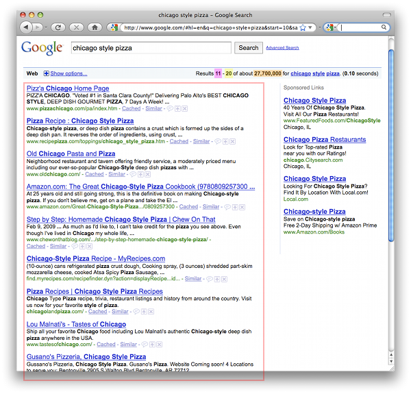
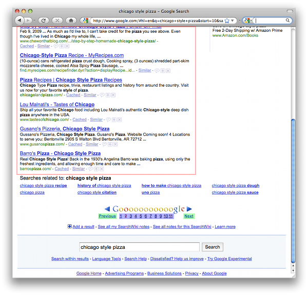

# Google JSON 风格指南

版本 0.9

<!-- mdformat off -->
* TOC
{:toc}
<!-- mdformat on -->

<a id="Introduction"></a>

## 简介

本风格指南记录了在 Google 构建 JSON API 时应遵循的准则与建议。
一般而言，JSON API 应遵循如下规范，其定义见
[JSON.org](https://www.json.org)。本风格指南对若干具体情形加以澄清并
做出统一规定，使来自 Google 的 JSON API 具有一致的外观
与体验。这些准则适用于基于 RPC 和基于 REST 的 API 中的
JSON 请求与响应。

<a id="Definitions"></a>

## 定义

就本风格指南而言，我们定义以下术语：

*   **属性（property）** - JSON 对象内部的名称/值对。
*   **属性名（property name）** - 属性中的名称（或键）部分。
*   **属性值（property value）** - 属性中的值部分。

<!-- end list -->

```json
{
  // The name/value pair together is a "property".
  "propertyName": "propertyValue"
}
```

JavaScript 的 `number` 类型涵盖了所有浮点数，这是一个
宽泛的称呼。在本指南中，`number` 指 JavaScript 的 `number`
类型，而 `integer` 则指整数。

<a id="General_Guidelines"></a>

## 通用准则

<a id="Comments"></a>

### 注释

JSON 对象中不要使用注释。

JSON 对象中不应包含注释。本风格指南中的部分示例
含有注释，但这只是为了把示例说明清楚。

<div class='badcode'></div>

```json
{
  // You may see comments in the examples below,
  // But don't include comments in your JSON.
  "propertyName": "propertyValue"
}
```

<a id="Double_Quotes"></a>

### 双引号

使用双引号。

如果某个属性需要引号，则必须使用双引号。所有属性名
都必须用双引号括起来。字符串类型的属性值也必须用
双引号括起来。其他值类型（如布尔值或数字）则不应
用双引号括起来。

<a id="Flattened_data_vs_Structured_Hierarchy"></a>

### 扁平数据与结构化层次

不应为了图方便而随意对数据进行分组。

在 JSON 表示中，数据元素应当“扁平化”。不应为了图方便
而随意对数据进行分组。

在某些情况下，例如一组属性共同表示单个结构时，
保留结构化层次可能更合理。这类情形应当仔细权衡，
并且只有在语义上说得通时才使用。例如，地址可以
用两种方式表示，但结构化方式对开发者来说
可能更合理：

扁平化地址：

```json
{
  "company": "Google",
  "website": "https://www.google.com/",
  "addressLine1": "111 8th Ave",
  "addressLine2": "4th Floor",
  "state": "NY",
  "city": "New York",
  "zip": "10011"
}
```

结构化地址：

```json
{
  "company": "Google",
  "website": "https://www.google.com/",
  "address": {
    "line1": "111 8th Ave",
    "line2": "4th Floor",
    "state": "NY",
    "city": "New York",
    "zip": "10011"
  }
}
```

<a id="Property_Name_Guidelines"></a>

## 属性命名准则

<a id="Property_Name_Format"></a>

### 属性名格式

选择含义明确的属性名。

属性名必须遵循以下准则：

*   属性名应当是含义明确、语义已定义的名称。
*   属性名必须
    采用[小写驼峰式](https://en.wikipedia.org/wiki/Camel_case)的 ASCII
    字符串。
*   首字符必须是字母、下划线（`_`）或美元符号
    （`$`）。
*   后续字符可以是字母、数字、下划线或
    美元符号。
*   应避免使用 JavaScript 的保留关键字（JavaScript
    保留关键字的完整列表见下文）。

这些准则与 JavaScript 标识符的命名准则相呼应。这
使得 JavaScript 客户端可以用点号表示法访问属性（例如
`result.thisIsAnInstanceVariable`）。下面是一个只含一个
属性的对象示例：

```json
{
  "thisPropertyIsAnIdentifier": "identifier value"
}
```

<a id="Key_Names_in_JSON_Maps"></a>

### JSON 映射中的键名

JSON 映射的键名可以使用任意 Unicode 字符。

当 JSON 对象用作映射时，属性名的命名规则不适用。
映射（也称为关联数组）是一种数据类型，包含任意的
键/值对，通过键来访问对应的值。JSON
对象与 JSON 映射在运行时看起来一样；这一区别与
API 的设计有关。API 文档应当说明何时将 JSON 对象
用作映射。

映射的键不必遵守属性名的命名准则。
映射的键可以包含任意 Unicode 字符。客户端可以使用
映射中常见的方括号表示法来访问这些属性（例如
`result.thumbnails["72"]`）。

```json
{
  // The "address" property is a sub-object
  // holding the parts of an address.
  "address": {
    "addressLine1": "123 Anystreet",
    "city": "Anytown",
    "state": "XX",
    "zip": "00000"
  },
  // The "thumbnails" property is a map that maps
  // a pixel size to the thumbnail url of that size.
  "thumbnails": {
    "72": "https://url.to.72px.thumbnail",
    "144": "https://url.to.144px.thumbnail"
  }
}
```

<a id="Reserved_Property_Names"></a>

### 保留属性名

某些属性名被保留下来，以便在各服务间保持一致的用法。

关于保留属性名的详细说明及完整列表，可在本指南
后文找到。服务应避免将这些属性名用于其既定
语义以外的用途。

<a id="Singular_vs_Plural_Property_Names"></a>

### 单数与复数属性名

数组类型的属性名应为复数。其他所有属性名都应为
单数。

数组通常包含多个条目，复数属性名正体现了这一点。
下文的保留名中就有这样的例子。`items` 属性名
是复数，因为它表示一个由条目对象组成的数组。其他
大多数字段都是单数。

此规则也可能有例外，尤其是在涉及数值型属性
值时。例如，在保留名中，`totalItems` 就比
`totalItem` 更合理。不过从技术上说，这并不违反风格指南，因为
`totalItems` 可以看作 `totalOfItems`，其中 `total` 是单数
（依风格指南），而 `OfItems` 用来限定这个总数。该字段名
也可以改成 `itemCount`，使其看起来是单数。

```json
{
  // Singular
  "author": "lisa",
  // An array of siblings, plural
  "siblings": ["bart", "maggie"],
  // "totalItem" doesn't sound right
  "totalItems": 10,
  // But maybe "itemCount" is better
  "itemCount": 10
}
```

<a id="Naming_Conflicts"></a>

### 命名冲突

通过选择新的属性名或对 API 进行版本化来避免命名冲突。

未来可能会有新属性加入保留列表。JSON 中没有
命名空间的概念。若出现命名冲突，通常可以通过选择新的
属性名或进行版本化来解决。例如，假设我们从以下
JSON 对象开始：

```json
{
  "apiVersion": "1.0",
  "data": {
    "recipeName": "pizza",
    "ingredients": ["tomatoes", "cheese", "sausage"]
  }
}
```

如果将来我们希望把 `ingredients` 变成保留字，可以
二选一：

1\) 换一个不同的名称：

```json
{
  "apiVersion": "1.0",
  "data": {
    "recipeName": "pizza",
    "ingredientsData": "Some new property",
    "ingredients": ["tomatoes", "cheese", "sausage"]
  }
}
```

2\) 在主版本边界上重命名该属性：

```json
{
  "apiVersion": "2.0",
  "data": {
    "recipeName": "pizza",
    "ingredients": "Some new property",
    "recipeIngredients": ["tomatoes", "cheese", "sausage"]
  }
}
```

<a id="Property_Value_Guidelines"></a>

## 属性值准则

<a id="Property_Value_Format"></a>

### 属性值格式

属性值必须是布尔值、数字、Unicode 字符串、对象、数组或
`null`。

[JSON.org](https://www.json.org) 上的规范明确规定了属性值中
允许哪些类型的数据，包括布尔值、数字、Unicode
字符串、对象、数组以及 `null`。不允许使用 JavaScript 表达式。
API 应对所有值支持该规范，并应为特定属性选择
最合适的数据类型（用数字表示数字，等等）。

好：

<div class='goodcode'></div>

```json
{
  "canPigsFly": null,     // null
  "areWeThereYet": false, // boolean
  "answerToLife": 42,     // number
  "name": "Bart",         // string
  "moreData": {},         // object
  "things": []            // array
}
```

坏：

<div class='badcode'></div>

```json
{
  "aVariableName": aVariableName,         // Bad - JavaScript identifier
  "functionFoo": function() { return 1; } // Bad - JavaScript function
}
```

<a id="Empty_Null_Property_Values"></a>

### 空属性值与 null 属性值

考虑去掉空值或 `null` 值。

如果某个属性是可选的，或其值为空或 `null`，则考虑
从 JSON 中移除该属性，除非有充分的语义理由
需要保留它。

```json
{
  "volume": 10,

  // Even though the "balance" property's value is zero, it should be left in,
  // since "0" signifies "even balance" (the value could be "-1" for left
  // balance and "+1" for right balance.
  "balance": 0

  // The "currentlyPlaying" property can be left out since it is null.
  // "currentlyPlaying": null
}
```

<a id="Enum_Values"></a>

### 枚举值

枚举值应表示为字符串。

随着 API 的演进，枚举值可能会被新增、删除或修改。
将枚举值表示为字符串，可以确保下游客户端能够从容
应对枚举值的变化。

Java 代码：

```java
public enum Color {
  WHITE,
  BLACK,
  RED,
  YELLOW,
  BLUE
}
```

JSON 对象：

```json
{
  "color": "WHITE"
}
```

<a id="Property_Value_Data_Types"></a>

## 属性值数据类型

如上所述，属性值的类型必须是布尔值、数字、字符串、
对象、数组或 `null`。不过，在处理某些值时，定义一组
标准数据类型会很有用。这些数据类型始终是
字符串，但会按特定方式格式化，以便
易于解析。

<a id="Date_Property_Values"></a>

### 日期属性值

日期应按 RFC 3339 的建议格式化。

日期应为字符串，并按以下规范的建议格式化：
[RFC 3339](https://www.ietf.org/rfc/rfc3339.txt)。

```json
{
  "lastUpdate": "2007-11-06T16:34:41.000Z"
}
```

<a id="Time_Duration_Property_Values"></a>

### 时长属性值

时长应按 ISO 8601 的建议格式化。

时长值应为字符串，并按以下规范的建议格式化：
[ISO 8601](https://en.wikipedia.org/wiki/ISO_8601#Durations)。

```json
{
  // three years, six months, four days, twelve hours,
  // thirty minutes, and five seconds
  "duration": "P3Y6M4DT12H30M5S"
}
```

<a id="Latitude_Longitude_Property_Values"></a>

### 纬度/经度属性值

纬度/经度应按 ISO 6709 的建议格式化。

纬度/经度应为字符串，并按以下规范的建议格式化：
[ISO 6709](https://en.wikipedia.org/wiki/ISO_6709)。此外，应
优先采用 ±DD.DDDD±DDD.DDDD 度格式。

```json
{
  // The latitude/longitude location of the statue of liberty.
  "statueOfLiberty": "+40.6894-074.0447"
}
```

<a id="JSON_Structure_and_Reserved_Property_Names"></a>

## JSON 结构与保留属性名

为了让各 API 保持一致的接口，JSON 对象应遵循
下文所列的结构。该结构同时适用于以 JSON 发出的请求
与响应。在此结构中，有若干属性名被保留用于
特定用途。这些属性并非必需；换句话说，每个保留属性
可以出现零次或一次。但如果某个服务需要这些属性，
则建议采用这一命名约定。下面是以
[Orderly](http://orderly-json.org/) 格式表示的 JSON 结构
模式（它进而可以编译为
[JSONSchema](https://json-schema.org/)）。你可以在本指南末尾
查看几个 JSON 结构的示例。

```
object {
  string apiVersion?;
  string context?;
  string id?;
  string method?;
  object {
    string id?
  }* params?;
  object {
    string kind?;
    string fields?;
    string etag?;
    string id?;
    string lang?;
    string updated?; # date formatted RFC 3339
    boolean deleted?;
    integer currentItemCount?;
    integer itemsPerPage?;
    integer startIndex?;
    integer totalItems?;
    integer pageIndex?;
    integer totalPages?;
    string pageLinkTemplate /^https?:/ ?;
    object {}* next?;
    string nextLink?;
    object {}* previous?;
    string previousLink?;
    object {}* self?;
    string selfLink?;
    object {}* edit?;
    string editLink?;
    array [
      object {}*;
    ] items?;
  }* data?;
  object {
    integer code?;
    string message?;
    array [
      object {
        string domain?;
        string reason?;
        string message?;
        string location?;
        string locationType?;
        string extendedHelp?;
        string sendReport?;
      }*;
    ] errors?;
  }* error?;
}*;
```

JSON 对象包含若干顶层属性，其后接 `data` 对象或
`error` 对象，但二者不可同时出现。下文将逐一
解释这些属性。

<a id="Top-Level_Reserved_Property_Names"></a>

## 顶层保留属性名

JSON 对象的顶层可以包含以下属性。

<a id="apiVersion"></a>

### apiVersion

属性值类型：`string` \
父级：-

表示请求中所需的服务 API 版本，以及响应中
所提供的服务 API 版本。`apiVersion` 应始终
存在。它与数据的版本无关。数据的版本管理
应通过 etag 之类的其他机制来处理。

示例：

```json
{ "apiVersion": "2.1" }
```

<a id="context"></a>

### context

属性值类型：`string` \
父级：-

客户端设置此值，服务器在响应中回传该数据。这在
JSON-P 和批量处理场景中很有用，用户可以用 `context`
把响应与请求对应起来。该属性之所以是顶层属性，
是因为无论响应成功还是出错，`context` 都应
存在。`context` 与 `id` 的区别在于，`context` 由用户
指定，而 `id` 由服务分配。

示例：

请求 #1：

```
https://www.google.com/myapi?context=bart
```

请求 #2：

```
https://www.google.com/myapi?context=lisa
```

响应 #1：

```json
{
  "context": "bart",
  "data": {
    "items": []
  }
}
```

响应 #2：

```json
{
  "context": "lisa",
  "data": {
    "items": []
  }
}
```

处理这两种响应的通用 JavaScript 处理程序代码：

```js
function handleResponse(response) {
  if (response.result.context == "bart") {
    // Update the "Bart" section of the page.
  } else if (response.result.context == "lisa") {
    // Update the "Lisa" section of the page.
  }
}
```

<a id="id"></a>

### id

属性值类型：`string` \
父级：-

服务器为响应提供的标识符（无论响应是成功
还是出错）。这有助于把服务器日志与客户端
收到的各条响应关联起来。

示例：

```json
{ "id": "1" }
```

<a id="method"></a>

### method

属性值类型：`string` \
父级：-

表示要对数据执行的操作，或已对数据执行的操作。
在 JSON 请求中，可以用 `method` 属性指明要
对数据执行哪种操作。在 JSON 响应中，`method`
属性可以指明已对数据执行的操作。

JSON-RPC 请求就是一个例子，其中 `method` 指明要
对 `params` 属性执行的操作：

```json
{
  "method": "people.get",
  "params": {
    "userId": "@me",
    "groupId": "@self"
  }
}
```

<a id="params"></a>

### params

属性值类型：`object` \
父级：-

此对象充当输入参数的映射，用于发送给 RPC 请求。
它可以与 `method` 属性配合使用，以执行某个 RPC
函数。如果某个 RPC 函数不需要参数，则可以省略
此属性。

示例：

```json
{
  "method": "people.get",
  "params": {
    "userId": "@me",
    "groupId": "@self"
  }
}
```

<a id="data"></a>

### data

属性值类型：`object` \
父级：-

用于容纳响应中所有数据的容器。该属性自身还有许多
保留属性名，将在下文描述。服务可以自由地向此对象
添加自己的数据。JSON 响应应包含 `data` 对象或
`error` 对象，但不可同时包含二者。若 `data` 与 `error`
同时存在，则以 `error` 对象为准。

<a id="error"></a>

### error

属性值类型：`object` \
父级：-

表示发生了错误，并附带错误详情。该错误
格式支持服务返回的一个或多个错误。JSON 响应
应包含 `data` 对象或 `error` 对象，但不可
同时包含二者。若 `data` 与 `error` 同时存在，则以 `error`
对象为准。

示例：

```json
{
  "apiVersion": "2.0",
  "error": {
    "code": 404,
    "message": "File Not Found",
    "errors": [{
      "domain": "Calendar",
      "reason": "ResourceNotFoundException",
      "message": "File Not Found"
    }]
  }
}
```

<a id="Reserved_Property_Names_in_the_data_object"></a>

## data 对象中的保留属性名

JSON 对象的 `data` 属性可以包含以下属性。

<a id="data.kind"></a>

### data.kind

属性值类型：`string` \
父级：`data`

`kind` 属性用来指示这个特定对象存储的是哪类
信息。它可以出现在 `data` 层级、
`items` 层级，或任何需要区分不同类型对象的
对象中。如果 `kind` 对象存在，它应是该对象中的
第一个属性（更多细节参见下文的 [属性排序](#Property_Ordering)
一节）。

示例：

```json
// "Kind" indicates an "album" in the Picasa API.
{"data": {"kind": "album"}}
```

<a id="data.fields"></a>

### data.fields

属性值类型：`string` \
父级：`data`

表示执行部分 GET 时响应中出现的字段，或执行
部分 PATCH 时请求中出现的字段。该属性应仅在
部分 GET/PATCH 期间存在，且不应为空。

示例：

```json
{
  "data": {
    "kind": "user",
    "fields": "author,id",
    "id": "bart",
    "author": "Bart"
  }
}
```

<a id="data.etag"></a>

### data.etag

属性值类型：`string` \
父级：`data`

表示响应的 etag。关于 GData API 中 ETag 的详情
可参见：
<https://code.google.com/apis/gdata/docs/2.0/reference.html#ResourceVersioning>

示例：

```json
{"data": {"etag": "W/\"C0QBRXcycSp7ImA9WxRVFUk.\""}}
```

<a id="data.id"></a>

### data.id

属性值类型：`string` \
父级：`data`

用于引用该对象的全局唯一字符串。关于
`id` 属性的具体细节由服务自行决定。

示例：

```json
{"data": {"id": "12345"}}
```

<a id="data.lang"></a>

### data.lang

属性值类型：`string`（按 BCP 47 的规定格式化） \
父级：`data`（或任意子元素）

指示此对象中其余属性所使用的语言。该属性
仿照 HTML 的 `lang` 属性和 XML 的 `xml:lang` 属性。
取值应为以下规范所定义的语言值：
[BCP 47](https://www.rfc-editor.org/rfc/bcp/bcp47.txt)。若单个 JSON 对象
包含多种语言的数据，服务应负责
为 `lang` 属性设计并文档化一个合适的位置。

示例：

```json
{"data": {
  "items": [
    { "lang": "en",
      "title": "Hello world!" },
    { "lang": "fr",
      "title": "Bonjour monde!" }
  ]}
}
```

<a id="data.updated"></a>

### data.updated

属性值类型：`string`（按 RFC 3339 的规定格式化） \
父级：`data`

指示该条目最后一次更新的日期/时间（[RFC 3339](https://www.ietf.org/rfc/rfc3339.txt)），
具体由服务定义。

示例：

```json
{"data": {"updated": "2007-11-06T16:34:41.000Z"}}
```

<a id="data.deleted"></a>

### data.deleted

属性值类型：`boolean` \
父级：`data`（或任意子元素）

这是一个标记元素，出现时表示所在的条目已被删除。
如果 `deleted` 存在，其值必须为 `true`；取值为 `false`
可能引起混淆，应当避免。

示例：

```json
{"data": {
  "items": [
    { "title": "A deleted entry",
      "deleted": true
    }
  ]}
}
```

<a id="data.items"></a>

### data.items

属性值类型：`array` \
父级：`data`

属性名 `items` 被保留用于表示由条目组成的数组
（例如 Picasa 中的照片、YouTube 中的视频）。这一设计
旨在为与当前结果相关的集合提供一个标准位置。
例如，可以把 JSON 输出接入一个通用的分页系统，
该系统知道按 `items` 数组分页。若 `items` 存在，
它应是 `data` 对象中的最后一个属性（详见下文的 [属性排序](#Property_Ordering)
一节）。

示例：

```json
{
  "data": {
    "items": [
      { /* Object #1 */ },
      { /* Object #2 */ },
      ...
    ]
  }
}
```

<a id="Reserved_Property_Names_for_Paging"></a>

## 用于分页的保留属性名

以下属性位于 `data` 对象中，用于帮助对条目列表
进行分页。其中部分措辞和概念借鉴自
[OpenSearch 规范](https://www.opensearch.org/)。

下列分页属性可支持多种分页方式，包括：

*   上一页/下一页分页 - 允许用户在一个列表中
    一次一页地前进或后退。`nextLink` 与 `previousLink`
    属性（在下文的
    [链接的保留属性名](#Reserved_Property_Names_for_Links)
    一节中描述）即用于这种分页方式。
*   基于索引的分页 - 允许用户直接跳到条目列表中
    某个特定的条目位置。例如，要加载从第 200 条开始的
    10 个条目，开发者可以让用户访问带有查询字符串
    `?startIndex=200` 的 URL。
*   基于页码的分页 - 允许用户直接跳到条目中的
    某一页。这与基于索引的分页类似，但省去了开发者
    为新一页条目计算条目索引的额外步骤。
    例如，开发者不必跳到第 200 条，而是可以
    跳到第 20 页。基于页码的分页中，URL 可以使用
    查询字符串 `?page=1` 或 `?page=20`。`pageIndex` 和 `totalPages`
    属性即用于这种分页方式。

关于如何使用这些属性实现分页的示例，可参见
本指南末尾。

<a id="data.currentItemCount"></a>

### data.currentItemCount

属性值类型：`integer` \
父级：`data`

此结果集中条目的数量。它应等价于 `items.length`，
作为一个便利属性提供。例如，假设某开发者
请求一组搜索条目，并要求每页 10 条。该搜索的
结果集共有 14 条。第一页将有 10 条，
因此 `itemsPerPage` 与 `currentItemCount` 都等于 `10`。下一页
将包含剩余的 4 条；`itemsPerPage` 仍为 `10`，而
`currentItemCount` 为 `4`。

示例：

```json
{
  "data": {
    // "itemsPerPage" does not necessarily match "currentItemCount"
    "itemsPerPage": 10,
    "currentItemCount": 4
  }
}
```

<a id="data.itemsPerPage"></a>

### data.itemsPerPage

属性值类型：`integer` \
父级：`data`

结果中条目的数量。它不一定等于
`data.items` 数组的大小；如果查看的是最后一页，
`data.items` 的大小可能小于 `itemsPerPage`。但 `data.items` 的
大小不应超过 `itemsPerPage`。

示例：

```json
{
  "data": {
    "itemsPerPage": 10
  }
}
```

<a id="data.startIndex"></a>

### data.startIndex

属性值类型：`integer` \
父级：`data`

`data.items` 中第一个条目的索引。为保持一致，`startIndex`
应从 1 开始计数。例如，第一组条目中的
第一个条目，其 `startIndex` 应为 1。若用户请求
下一组数据，`startIndex` 可能为 10。

示例：

```json
{
  "data": {
    "startIndex": 1
  }
}
```

<a id="data.totalItems"></a>

### data.totalItems

属性值类型：`integer` \
父级：`data`

此集合中可用的条目总数。例如，若某用户有 100 篇
博文，响应可能只包含 10 条，但 `totalItems` 会是
100。

示例：

```json
{
  "data": {
    "totalItems": 100
  }
}
```

<a id="data.pagingLinkTemplate"></a>

### data.pagingLinkTemplate

属性值类型：`string` \
父级：`data`

一个 URI 模板，指明用户如何计算后续的分页链接。该
URI 模板还带有一些保留变量名：`{index}` 表示要加载的
条目编号，`{pageIndex}` 表示要加载的页码。

示例：

```json
{
  "data": {
    "pagingLinkTemplate": "https://www.google.com/search/hl=en&q=chicago+style+pizza&start={index}&sa=N"
  }
}
```

<a id="data.pageIndex"></a>

### data.pageIndex

属性值类型：`integer` \
父级：`data`

当前条目页的索引。为保持一致，`pageIndex` 应
从 1 开始计数。例如，第一页的 `pageIndex` 为 1。
`pageIndex` 也可以由基于条目的分页属性计算得出：
`pageIndex = floor(startIndex / itemsPerPage) + 1`。

示例：

```json
{
  "data": {
    "pageIndex": 1
  }
}
```

<a id="data.totalPages"></a>

### data.totalPages

属性值类型：`integer` \
父级：`data`

结果集中的总页数。`totalPages` 也可以由上文
基于条目的分页属性计算得出：
`totalPages = ceiling(totalItems / itemsPerPage)`。

示例：

```json
{
  "data": {
    "totalPages": 50
  }
}
```

<a id="Reserved_Property_Names_for_Links"></a>

## 链接的保留属性名

以下属性位于 `data` 对象中，表示对其他资源的
引用。链接属性有两种形式：

1.  对象，可以包含任意类型的引用（例如 JSON-RPC
    对象），以及
2.  URI 字符串，表示指向资源的 URI（并且始终以
    `Link` 为后缀）。

<a id="data.self"></a>

### data.self / data.selfLink

属性值类型：`object` / `string` \
父级：`data`

self 链接可用于获取该条目的数据。例如，在
某用户的 Picasa 相册列表中，`items` 数组里的每个
相册对象都可以包含一个 `selfLink`，用于获取该相册的数据。

示例：

```json
{
  "data": {
    "self": {},
    "selfLink": "https://www.google.com/feeds/album/1234"
  }
}
```

<a id="data.edit"></a>

### data.edit / data.editLink

属性值类型：`object` / `string` \
父级：`data`

edit 链接指明用户可以向何处发送更新或删除请求。
这对基于 REST 的 API 很有用。仅当用户可以
更新/删除该条目时，才需要出现此链接。

示例：

```json
{
  "data": {
    "edit": {},
    "editLink": "https://www.google.com/feeds/album/1234/edit"
  }
}
```

<a id="data.next"></a>

### data.next / data.nextLink

属性值类型：`object` / `string` \
父级：`data`

next 链接指明如何获取更多数据。它指向加载
下一组数据的位置。它可以与
`itemsPerPage`、`startIndex` 和 `totalItems` 属性
配合使用，以便对数据进行分页。

示例：

```json
{
  "data": {
    "next": {},
    "nextLink": "https://www.google.com/feeds/album/1234/next"
  }
}
```

<a id="data.previous"></a>

### data.previous / data.previousLink

属性值类型：`object` / `string` \
父级：`data`

previous 链接指明如何获取更多数据。它指向加载
上一组数据的位置。它可以与
`itemsPerPage`、`startIndex` 和 `totalItems` 属性
配合使用，以便对数据进行分页。

示例：

```json
{
  "data": {
    "previous": {},
    "previousLink": "https://www.google.com/feeds/album/1234/next"
  }
}
```

<a id="Reserved_Property_Names_in_the_error_object"></a>

## error 对象中的保留属性名

JSON 对象的 `error` 属性可以包含以下属性。

<a id="error.code"></a>

### error.code

属性值类型：`integer` \
父级：`error`

表示此错误的代号。该属性的值通常表示
HTTP 响应码。若存在多个错误，则 `code` 为
第一个错误的代号。

示例：

```json
{
  "error": {
    "code": 404
  }
}
```

<a id="error.message"></a>

### error.message

属性值类型：`string` \
父级：`error`

一条人类可读的消息，提供关于该错误的更多细节。
若存在多个错误，则 `message` 为第一个错误的消息。

示例：

```json
{
  "error": {
    "message": "File Not Found"
  }
}
```

<a id="error.errors"></a>

### error.errors

属性值类型：`array` \
父级：`error`

用于容纳与该错误有关的任何附加信息。若服务
返回多个错误，则 `errors` 数组中的每个元素表示
一个不同的错误。

示例：

```json
{ "error": { "errors": [] } }
```

<a id="error.errors.domain"></a>

### error.errors\[\].domain

属性值类型：`string` \
父级：`error.errors`

引发此错误的服务的唯一标识符。这有助于区分
特定于服务的错误（例如在日历中插入事件时出错）与
通用的协议错误（例如文件未找到）。

示例：

```json
{
  "error": {
    "errors": [{"domain": "Calendar"}]
  }
}
```

<a id="error.errors.reason"></a>

### error.errors\[\].reason

属性值类型：`string` \
父级：`error.errors`

此错误的唯一标识符。与 `error.code` 属性的不同
之处在于，它不是 HTTP 响应码。

示例：

```json
{
  "error": {
    "errors": [{"reason": "ResourceNotFoundException"}]
  }
}
```

<a id="error.errors.message"></a>

### error.errors\[\].message

属性值类型：`string` \
父级：`error.errors`

一条人类可读的消息，提供关于该错误的更多细节。
若只有一个错误，此字段将与 `error.message` 一致。

示例：

```json
{
  "error": {
    "code": 404,
    "message": "File Not Found",
    "errors": [{"message": "File Not Found"}]
  }
}
```

<a id="error.errors.location"></a>

### error.errors\[\].location

属性值类型：`string` \
父级：`error.errors`

错误发生的位置（其值的解释方式取决于
`locationType`）。

示例：

```json
{
  "error": {
    "errors": [{"location": ""}]
  }
}
```

<a id="error.errors.locationType"></a>

### error.errors\[\].locationType

属性值类型：`string` \
父级：`error.errors`

指明应如何解释 `location` 属性。

示例：

```json
{
  "error": {
    "errors": [{"locationType": ""}]
  }
}
```

<a id="error.errors.extendedHelp"></a>

### error.errors\[\].extendedHelp

属性值类型：`string` \
父级：`error.errors`

一个 URI，指向可能有助于进一步说明该错误的帮助文本。

示例：

```json
{
  "error": {
    "errors": [{"extendedHelper": "https://url.to.more.details.example.com/"}]
  }
}
```

<a id="error.errors.sendReport"></a>

### error.errors\[\].sendReport

属性值类型：`string` \
父级：`error.errors`

一个 URI，指向服务用于收集错误状况数据的报告表单。
此 URI 应预先填入描述该请求的参数。

示例：

```json
{
  "error": {
    "errors": [{"sendReport": "https://report.example.com/"}]
  }
}
```

<a id="Property_Ordering"></a>

## 属性排序

JSON 对象中的属性可以按任意顺序排列。不过，在某些情况下，
属性的顺序有助于解析器快速解读数据，并带来
更好的性能。一个例子是移动环境中的拉取式解析器，
在那里性能与内存都至关重要，应避免不必要的解析。

<a id="Kind_Property"></a>

### Kind 属性

`kind` 应是第一个属性。

假设某个解析器负责把原始 JSON 流解析为特定的
对象。`kind` 属性会引导解析器实例化相应的
对象。因此它应是 JSON 对象中的第一个属性。这
仅适用于带有 `kind` 属性的对象（通常出现在 `data` 和
`items` 属性中）。

<a id="Items_Property"></a>

### Items 属性

`items` 应是 `data` 对象中的最后一个属性。

这样可以在读取每个单独条目之前，先读完集合的
所有属性。当条目很多时，若开发者只需要数据中的
字段，这可以避免对这些条目做不必要的
解析。

<a id="Property_Ordering_Example"></a>

### 属性排序示例

```json
// The "kind" property distinguishes between an "album" and a "photo".
// "Kind" is always the first property in its parent object.
// The "items" property is the last property in the "data" object.
{
  "data": {
    "kind": "album",
    "title": "My Photo Album",
    "description": "An album in the user's account",
    "items": [
      {
        "kind": "photo",
        "title": "My First Photo"
      }
    ]
  }
}
```

<a id="Examples"></a>

## 示例

<a id="YouTube_JSON_API"></a>

### YouTube JSON API

下面是 YouTube JSON API 响应对象的示例。你可以在
此处进一步了解 YouTube 的 JSON API：
<https://code.google.com/apis/youtube/2.0/developers_guide_jsonc.html>.

```json
{
  "apiVersion": "2.0",
  "data": {
    "updated": "2010-02-04T19:29:54.001Z",
    "totalItems": 6741,
    "startIndex": 1,
    "itemsPerPage": 1,
    "items": [
      {
        "id": "BGODurRfVv4",
        "uploaded": "2009-11-17T20:10:06.000Z",
        "updated": "2010-02-04T06:25:57.000Z",
        "uploader": "docchat",
        "category": "Animals",
        "title": "From service dog to SURFice dog",
        "description": "Surf dog Ricochets inspirational video ...",
        "tags": [
          "Surf dog",
          "dog surfing",
          "dog",
          "golden retriever"
        ],
        "thumbnail": {
          "default": "https://i.ytimg.com/vi/BGODurRfVv4/default.jpg",
          "hqDefault": "https://i.ytimg.com/vi/BGODurRfVv4/hqdefault.jpg"
        },
        "player": {
          "default": "https://www.youtube.com/watch?v=BGODurRfVv4&feature=youtube_gdata",
          "mobile": "https://m.youtube.com/details?v=BGODurRfVv4"
        },
        "content": {
          "1": "rtsp://v5.cache6.c.youtube.com/CiILENy73wIaGQn-Vl-0uoNjBBMYDSANFEgGUgZ2aWRlb3MM/0/0/0/video.3gp",
          "5": "https://www.youtube.com/v/BGODurRfVv4?f=videos&app=youtube_gdata",
          "6": "rtsp://v7.cache7.c.youtube.com/CiILENy73wIaGQn-Vl-0uoNjBBMYESARFEgGUgZ2aWRlb3MM/0/0/0/video.3gp"
        },
        "duration": 315,
        "rating": 4.96,
        "ratingCount": 2043,
        "viewCount": 1781691,
        "favoriteCount": 3363,
        "commentCount": 1007,
        "commentsAllowed": true
      }
    ]
  }
}
```

<a id="Paging_Example"></a>

### 分页示例

本示例演示了如何将 Google 搜索条目表示为一个
JSON 对象，并特别关注分页变量。

此示例仅用于说明目的。下面这个 API 实际上并不
存在。

下面是一个 Google 搜索结果页示例：





下面是该页面的 JSON 表示示例：

```json
{
  "apiVersion": "2.1",
  "id": "1",
  "data": {
    "query": "chicago style pizza",
    "time": "0.1",
    "currentItemCount": 10,
    "itemsPerPage": 10,
    "startIndex": 11,
    "totalItems": 2700000,
    "nextLink": "https://www.google.com/search?hl=en&q=chicago+style+pizza&start=20&sa=N",
    "previousLink": "https://www.google.com/search?hl=en&q=chicago+style+pizza&start=0&sa=N",
    "pagingLinkTemplate": "https://www.google.com/search/hl=en&q=chicago+style+pizza&start={index}&sa=N",
    "items": [
      {
        "title": "Pizz'a Chicago Home Page"
        // More fields for the search results
      }
      // More search results
    ]
  }
}
```

下面说明截图中各个彩色框会如何表示
（背景色与上图中的颜色一一对应）：

*   结果 <span style="background-color:rgb(180, 167, 214)">11</span> - 20 条，
    共约 2,700,000 条 = `startIndex`
*   结果 11 - <span style="background-color:rgb(255, 217, 102)">20</span> 条，
    共约 2,700,000 条 = `startIndex + currentItemCount - 1`
*   结果 11 - 20 条，共约
    <span style="background-color:rgb(246, 178, 107)">2,700,000</span> =
    `totalItems`
*   <span style="background-color:rgb(234, 153, 153)">搜索结果</span> =
    `items`（按适当方式格式化）
*   <span style="background-color:rgb(182, 215, 168)">上一页/下一页</span> =
    `previousLink` / `nextLink`
*   <span style="background-color:rgb(159, 197, 232)">“Gooooooooooogle” 中的
    编号链接</span> = 由 `pageLinkTemplate` 派生而来。开发者负责
    计算 `{index}` 的取值，并将这些值代入
    `pageLinkTemplate`。`pageLinkTemplate` 的 `{index}`
    变量按以下方式计算：
    *   索引 #1 = `0 * itemsPerPage = 0`
    *   索引 #2 = `2 * itemsPerPage = 10`
    *   索引 #3 = `3 * itemsPerPage = 20`
    *   索引 #N = `N * itemsPerPage`

<a id="Appendix"></a>

## 附录

<a id="Appendix_A"></a>

### 附录 A：JavaScript 保留字

属性名中应避免使用的 JavaScript 保留字列表。

以下词汇由 JavaScript 语言保留，不能使用点号表示法引用。
本列表反映了目前对关键字的最佳了解；该列表可能会
根据具体执行环境而变化或有所不同。

摘自
[ECMAScript 语言规范第 5 版](https://www.ecma-international.org/publications-and-standards/standards/ecma-262/)：

<div class='badcode'></div>

```
abstract
boolean break byte
case catch char class const continue
debugger default delete do double
else enum export extends
false final finally float for function
goto
if implements import in instanceof int interface
let long
native new null
package private protected public
return
short static super switch synchronized
this throw throws transient true try typeof
var volatile void
while with
yield
```
